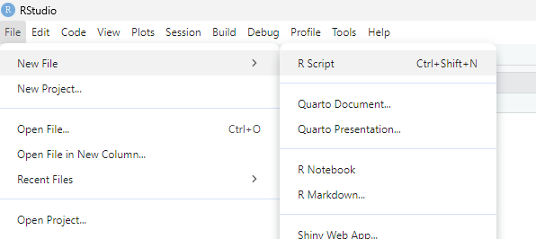
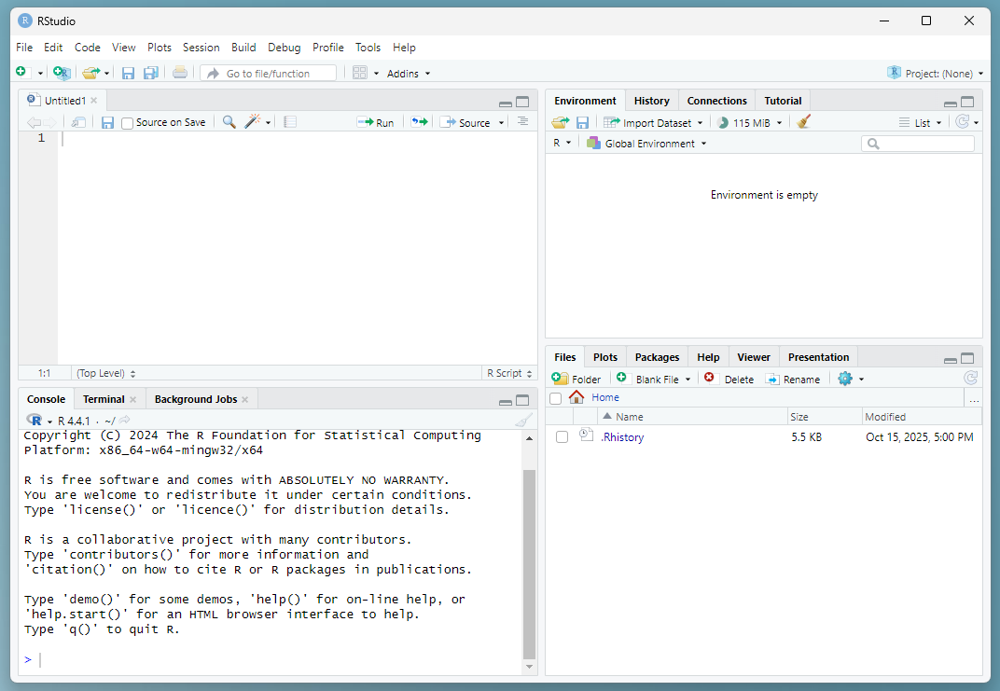
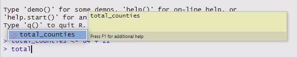
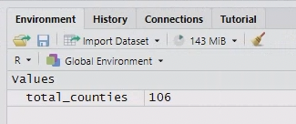
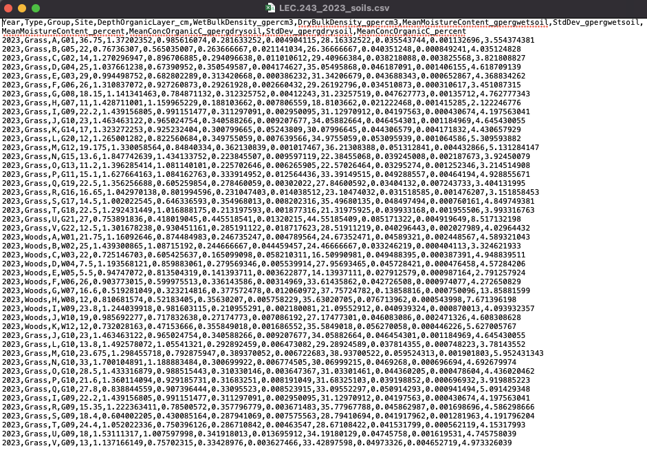
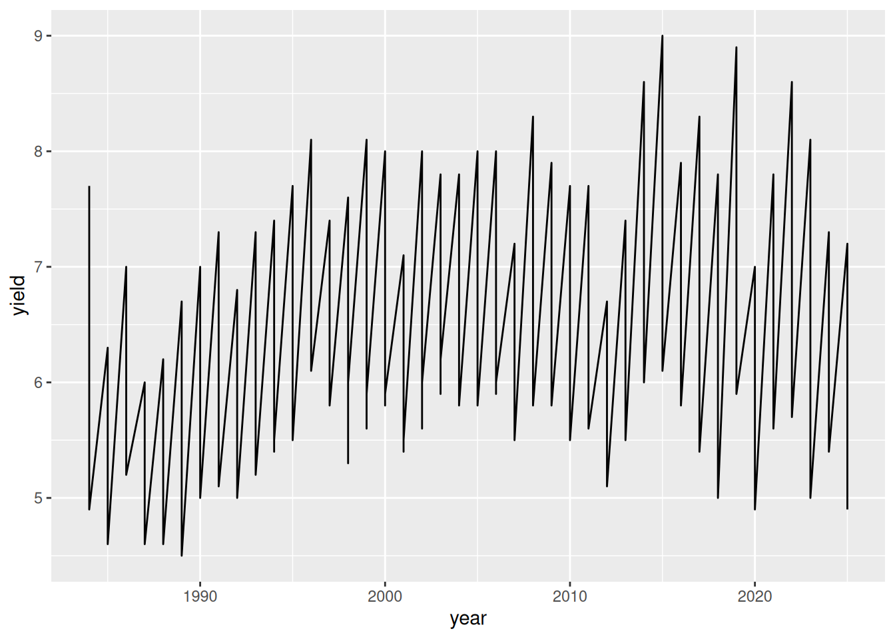
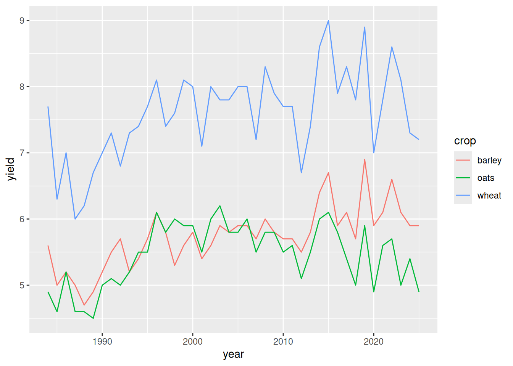
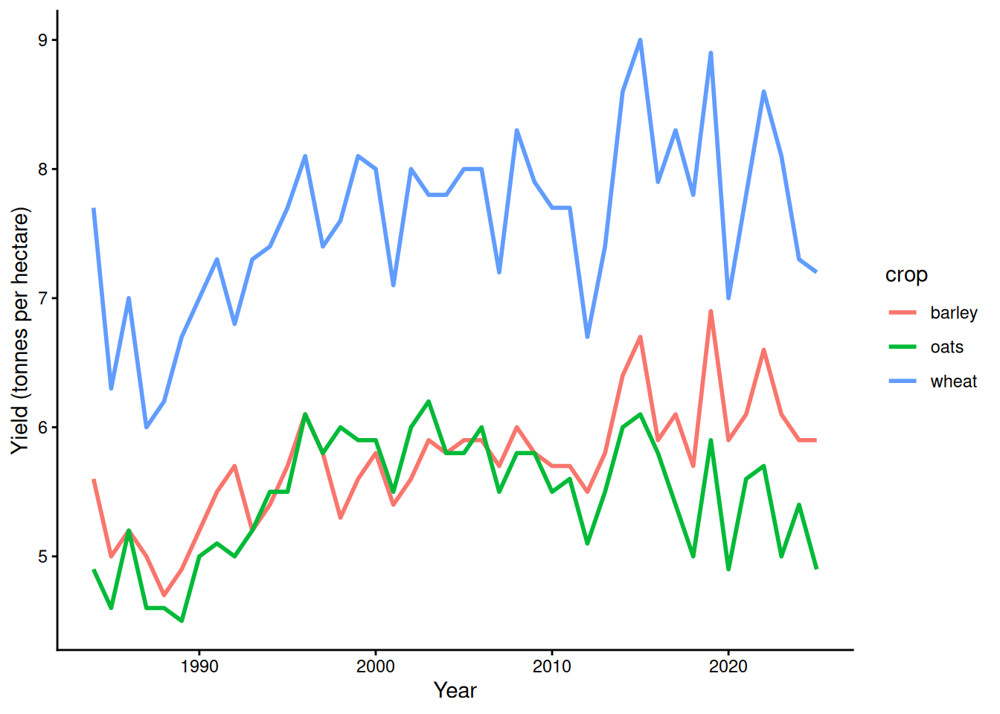

# (PART) Week 2 {-}

# Introduction

## What are R and RStudio?

**R** is a free, open-source programming language designed for statistical computing and graphics. It is the most commonly used tool for statistical analysis in ecology and the preferred tool in biology.

**RStudio** is a free, open-source integrated development environment (IDE) that makes coding in R much easier.

A metaphor that you may find useful:

> R is the engine that drives the wheels of the car, but RStudio is what you interact with to control it: the steering wheel, the seat, the gear box, and the pedals. 

## Why use R and RStudio?

- The ability to use R (and having coding skills more generally) are highly sought after skills that will make you much more competitive when you apply to jobs.
- R and RStudio are both free and open-source. This means you'll be able to keep using them after you leave Lancaster University.
- R uses scripts of code (i.e. instructions) to perform analyses instead of pointing and clicking with a mouse. This makes it easier to re-run an analysis and share code, making science more transparent and reproducible. 
- R is a bit harder to learn than Excel and point-and-click statistics programs initially; however, once you learn it, it is much more powerful and capable of doing more complex tasks.
- A significant portion of modern tools for analysis in ecology, environmental science, psychology, and many other fields are written in R. This library of tools is being constantly updating as researchers create new ones and improve old ones.

That said, these practicals are not really about coding *per se*. We do not expect you to become master coders during this module. We do expect that you will be able to interpret, modify, and use R code to perform some basic data manipulation and visualisation.

## Learning to code

These practical exercises will be a bit like an immersive foreign language program - you will gradually learn how to code after repeated exposure and practice.

This first practical exercise in R will tell you exactly what you need to do. (You will still need to _do it_, but the instructions will be complete.)

As you progress through the five weeks of R, the instructions will gradually leave more and more puzzles for you to solve.

### Patience is key

In my experience, it generally takes LEC undergraduate students 3-4 practicals in order to feel somewhat comfortable coding in R. 

Do not get discouraged if it feels like it takes you longer than your "normal" to understand what is going on.

Learning how to code is not just learning science content like you are used to, it is learning a whole new way to think. This process necessarily takes time, and we have incorporated this need for time and repetition into the practical design.

I have yet to encounter a student who is incapable of learning R - even the art, music, history and literature students that I taught as part of a science literacy class in America. 

### A common misconception

Beginner coders are often under the impression that more advanced programmers have all of the commands they need memorized and write everything out perfectly the first time. In fact, nothing could be farther from the truth.

::: {.rmdtip}
**Tip!** The two most important skills you need to be a successful coder are:

1. **Looking things up** as you code them, either online, in help files, or from previous work. (Most biologists work by adapting example code.)
2. **Debugging** your code - things rarely work the first time!

These skills are key parts of the coding process, no matter how advanced you become. Embrace them.
:::

# Working with R and RStudio

## Accessing the LEC R server

For your Lancaster University modules, the best way to access R and RStudio is through the LEC R server.

The LEC R server is accessed through a browser window. You will not need to download any software, and it will work on any device.

The LEC R server can be found at the following link: [https://lec-rstudio.lancaster.ac.uk](https://lec-rstudio.lancaster.ac.uk).

### On campus

If you are on campus and using Lancaster University internet, you will be able to connect directly to the R server.

### Off campus

If you are off campus (and therefore not using Lancaster University internet), you will need to use the Global Protect VPN, which allows you to access some services and IT as if you were physically located on campus. There are instructions for how to set up the VPN on your personal computer at: [https://portal.lancaster.ac.uk/ask/vpn/](https://portal.lancaster.ac.uk/ask/vpn/).

If you are someone who enjoys and feels confident using open source software, you can also install [R](https://www.r-project.org/) and [RStudio](https://posit.co/downloads) on your personal computer.

You will need to download and install R first, and then RStudio second. Use the links above and follow the directions on the websites. Make sure you select the right software versions for your operating system. 

When you are running the software on your computer, RStudio will communicate with and use R for you - you do not have to run R separately.

## The RStudio interface

If you haven't done so yet, open the [LEC R server](https://lec-rstudio.lancaster.ac.uk) in a browser window.

Before we do anything else, click on File > New File > R Script to create a new R script. This should open up a new panel in your window.

<div style="text-align: center;">



</div>

Now the RStudio window should be divided into four quadrants:

- *Top left*: Code files - where you can see and edit your saved code files (called "**scripts**"), including this R markdown document. Some types of data can also be viewed here.
- *Bottom left*: `Console` - where you can input commands and see code that has been run. This is also where text-based output gets printed if you are using a regular R script instead of an R markdown file.
- *Top right*: `Environment` - where you can see the saved data objects in your current R workspace.
- *Bottom right*: This has several useful tabs: `Files` - which shows all the files on your server account; `Help` - where you can look up documentation about specific commands; and `Plots` - where images appear if you are using a regular R script instead of an R markdown file. (Ours will appear inside the code file instead.)

Most of the time when work you in R, you'll type your code into a script file. 

<div style="text-align: center;">

{width=100%}

</div>
::: {.rmdwarning}
***Warning!*** Although you can run code from both the script pane (top left) and console pane (bottom left), there is a big difference between them!!!

- If you type something into the script pane you can run it multiple times and save it for future use.
- If you type something into the console pane, it will run once and then disappear.

So make sure that you are typing your code into the right location!

This will almost always be a script file, not the console.
:::

## The building blocks of code

To help us talk about coding, we need to learn some vocabulary. Five essential building blocks of any coding language are:

1. Operators
2. Variables
3. Functions
4. Arguments
5. Comments

We'll learn about each of them and practice typing some code into the Console and running it from there.

### Operators

**Operators** are typically 1 or 2-character commands that correspond to very simple, common tasks.

For instance, all of the basic mathematical symbols are operators in most programming languages, e.g., `+` (addition), `-` (subtraction), `*` (multiplication), and `/` (division).  In R, exponents can be expressed with either the caret, `^`, or a double asterisk, `**`.

Thus, like Excel, R can function as a basic calculator. 

Type `84 + 22` directly into the Console (bottom left quadrant, labeled "Console") and hit Enter.


``` r
84 + 22
#> [1] 106
```

### Variables / Objects

Data can be saved as named **variables**, which allows you to refer to and use them later. In R these are usually called objects since the word "variable" is frequently used in the statistical sense instead. You can think of variables as analogous to nouns.

- In R, we use the arrow operator `<-` to save objects.
- We can save the output from our command above using the following code: `total_counties <- 84 + 22`.
- Then whenever we use the object `total_counties`, R will substitute the value `106`.

Create and store an object by typing `total_counties <- 84 + 22` into the Console and hit Enter. Now type `total_counties` and hit Enter.


``` r
total_counties <- 84 + 22
total_counties
#> [1] 106
```

::: {.rmdtip}
**Tip:** As you type, RStudio will suggest objects that are stored in your environment that start with the same characters.

You can either:

- click on them
- Use the arrow keys + Enter to select them.

This will save you time and also prevent typos from causing bugs!
:::

<div style="text-align: center;">



</div>

Now you should be able to see the `total_counties` object in your `Environment` panel.

<div style="text-align: center;">



</div>

### Functions

**Functions** are the commands that tell the program to do something. You can think of them as the verbs of a programming language. Functions are always followed by a set of brackets.

For example, the function `getwd()` will provide your current _working directory_ (the location where R will read and save files).

Type the function `getwd()` into the Console and hit Enter. (Your output will look different than mine, because I'm using a different computer.)


``` r
getwd()
#> [1] "/home/runner/work/LECFoundationsBookdown/LECFoundationsBookdown"
```

::: {.rmdtip}
**Info:** As you type the command `getwd()`, RStudio will automatically add the ending bracket when you type the starting bracket. (You will see later that it also does the same thing with quotation marks.)

This helps avoid introducing bugs from forgetting to close your brackets.
:::

### Arguments

Most functions also take inputs called **arguments** that go inside the parentheses. Arguments are generally either:

1) Data to process
2) Settings that tell the function how to process the data

For example, the function `sqrt(x)` takes one argument, `x`, and calculates its square root.

Type `sqrt(4)` into the Console and hit Enter.


``` r
sqrt(4)
#> [1] 2
```

One operator that can be useful for getting arguments into functions in R is the **pipe** operator: `|>`

The pipe operator passes data to the first argument of the next function. (You'll see why this is useful later.)

For now, type `9 |> sqrt()` into the Console and hit Enter.


``` r
9 |> sqrt()
#> [1] 3
```

### Comments

**Comments** are another critical part of coding, although not part of the code itself. Comments explain what the code is doing, and are a crucial part of making your code understandable to both other people and to yourself. (Every programmer hates the feeling of going back to old code days/weeks/months/years after you first wrote it and thinking "What the #$&! was I doing here????" Commenting your code properly makes your life much easier.)

* In R, comments are preceded by the hash symbol `#`.
* The `#` symbol tells R to ignore whatever else follows on that line in the script (i.e. not interpret it as code).

Type the statement `# Hello world!` into the Console and hit Enter.

There will be no output - because you've told R to ignore your input.


``` r
#hello world!
```

## Running code from a script

Now that you've run some basic code via the `Console`, we're going to learn how to do it from a script file.

Almost all of the time that you are running code, you will do it from a script.

::: {.rmdtip}
**Info:** Running code from a *script file*, instead of from the Console, has several benefits:

- Everything you've done is clearly documented.
- You can re-run any part of your code if needed.
- You can save your code to refer to or repeat again later.
- Your analysis can be easily shared with and repeated by someone else.

These are some of the core reasons for using a coding-based statistics tool - it makes your analyses **transparent** and **reproducible**. 
:::

### Two methods for running code

There are two methods to run bits of code from a script.

1. Press `Ctrl + Enter` 
2. Click the `Run` button with the green arrow near the top right of the script panel

For both methods, you can either move your cursor to a specific line of code to run just that line, or highlight a larger portion of code to run the whole selection.

You can also run an entire script using the `source` button with the blue arrow to the right of the `Run` button.

Type the following code into your R script file. Run the code using all three methods.

- First practice running each line separately, and watch what happens in the console after each command.
- Then try running all the lines at once, using highlighting and using the `source` button.

(Note: I've turned off the results in the code chunk below, so all you can see is the code itself.)

::: {.rmdtip}
**Info:** Copying and pasting code from the instructions can be faster, but typing the code out yourself will make it easier to learn and remember what you are doing.

I recommend typing code out whenever we are learning something in these practicals, but then copying and pasting when you are doing the analysis for your coursework later on.
:::


``` r
# Random practice code
a <- 3
b <- 5
a + b
a^2
b * a
b**a
1:5
y <- c(2, 4, 6, 8, 10)
y
z <- b/a
z
z <- "Lancaster"
z
```

::: {.rmdtip}
***Tips!***

Two important bits of R syntax (syntax = rules for how a language works):

- The colon operator tells R to list out every integer number between A and B, when written as `A:B`.
- The small letter `c` (short for the term "concatenate") is used to group data together. 

In both cases above, the output is an object called a **vector**.

You can think of a vector like a list of data (although the word list actually specifically refers to a specific type of data object in R that we aren't using).

We'll use both of these operations later in this practical.
:::

::: {.rmdquestion}
**Q:** What happens to the variable `z` when you run the second-to-last line of code? Why might that be a problem?
:::

## Fixing common mistakes

### Error messages

Being able to interpret error messages to fix your mistakes is an important part of coding.

The red text may seem scary, but usually it will contain a good clue to help you with debugging your code. 

Type the following bits of code **into the Console** and see if you can figure out what the problem is for each of the very common mistakes below based on the error message.

```r
sqrt()
```

```r
Lancaster + 5
```

```
"Lancaster" + 5 
```

::: {.rmdtip}
**Tip:** If you want to make something character-type data, put it in quotation marks. Otherwise R will assume that it is referring to a saved variable.
:::

### Why am I seeing plus signs?

If you give R instructions (in the form of code), R will wait until it thinks the instructions are complete before it allows you to do anything else.

Sometimes errors in your code (often an unmatched bracket) will mean that you think you have written a complete set of instructions, but R is still waiting for more (e.g. a closing bracket).

When this happens, you will see `+` in the Console instead of `>`. This indicates that R thinks that there's still more code to come.

::: {.rmdtip}
**Tip:** If R gets stuck in unfinished code and the Console has `+` at the start of the line, hit `Esc` to exit the current task.
:::

Practice getting stuck with R waiting for more code and then using `Esc` to get out of it by running the incomplete function below.

```r
sqrt(
```

### Getting help from R documentation

Sometimes a function is not working and you can't immediately see why. Luckily R stores documentation for (nearly) all its functions directly for you to refer to!

Type the following code into your R **console** and run it. 

```r
?sqrt
```

This should bring up a help page that outlines the function, what it does, and how to use it.

It also lists what arguments a function expects and what to put in them.

You can also search for functions in the Help tab's search bar.

Search for `read.csv` in the Help tab and skim the documentation quickly.

::: {.rmdtip}
**Tip:** Within this website, you'll see that some function names are automatically converted to links e.g. `mean()`. You can click on these and it will take you to a web version of the internal help page for that function!
:::

## Loading packages

Before we can continue, we will need to load some packages.

A package is a set of extra functions that are not part of the basic R installation but can be added on later. You can think of them like apps that enhance R.

Today we will be using three packages that are all part of what's called the `tidyverse`, a philosophy/approach for coding in R. They are:

- `dplyr` - a data manipulation package.
- `tidyr` - a package for helping you clean and reshape messy data.
- `ggplot2` - a package for plotting.

::: {.rmdwarning}
**Warning:** If you start working on the desktop version of R and RStudio (i.e. with the software downloaded and installed on your personal computer) you will also need to install the packages by going to Tools > Install Package and then typing the names of the packages.

However, these packages are already installed on the LEC R server.
:::

### The library() function

You generally load packages using the `library()` function.

At the very top of your script, use the enter key to make some extra line spaces. Then type and run the following code.

There will be some output in the Console that you can ignore.


``` r
library(dplyr)
library(tidyr)
library(ggplot2)
```


# Working with data


In order to work with data in R, first you need to read the data into R.

## Data file formats

Many datasets are stored as Excel files, like the workbook that you made for the census data in last week's practical. Excel files can contain lots of complex information besides text, like pretty formatting (coloured cells, bolded text, etc.), formulas with cell references, and graphs.

However, R can't read Excel files directly, and it doesn't like all those extra bells and whistles.

R needs the data as a comma separated value, or `.csv` file, that **only contains information as text** (i.e. numbers, letters, and certain types of punctuation). (You may remember that the original census data from the UK government that you used last week were `.csv` files.)

::: {.rmdtip}
Any Excel file can be saved as a `.csv` file using the 'Save As' menu option.
:::

You'll practice doing it yourself in a later practical, but for today's exercise, we've already done it for you. 

Unsurprisingly based on the name, a `.csv` file has values separated by commas. You can open one in a text editor and it will look something like this:

<div style="text-align: center;">

{width=100%}

</div>

Yuck. Pretty difficult for a human to work with, but it's perfect for R.

## Getting today's data

Download the dataset for today (`FoodPractical_data.csv`) from the Week 2 section on the LECX4101 Moodle page.

This dataset contains UK **crop yield data (in tonnes per hectare) for 3 different cereal crops (wheat, barley, and oats) from 1984-2025.**

The data are part of a larger dataset published annually by the Defra (Department of Environment, Food, and Rural Affairs), a part of the UK government. The data are part of _Chapter 7: Crops of Agriculture in the United Kingdom_, which can be found [here](https://www.gov.uk/government/statistics/agriculture-in-the-united-kingdom-2025/chapter-7-crops). There is a link to download the full dataset under every table in the report.

Upload the `.csv` file to the R server via the `Files` pane in the bottom-right quadrant.

The upload button is the middle and has a golden circle with a white arrow pointing up.

## Reading in data

Next you will read the data into R using the `read.csv()` function, and store it (using the arrow operator) as an object called `cropdata`.

After your section of random practice code, make some line spaces, and type the code below into your script file and run it.


```r
cropdata <- read.csv("FoodPractical_data.csv")
```

You should see it pop up in your Environment pane in the top-right quadrant.

## Data frames

R loads data as a specific type of object called a **data frame** that has observations (rows) of variables (columns).

- Each column has a name taken from the top row of your `.csv` file.
- Each rows is numbered sequentially, starting with the number 1.

### Examining data frames

::: {.rmdquestion}
**Q:** Look at the `Environment` tab. How many observations and variables does the UK crop data frame have?
:::

Click on the blue circle just to the left of the data frame in the `Environment` tab. It should drop down a preview of all the variables and their first few values.

Click on the name `cropdata`. It should open a table in your scripts panel. Scroll down to examine the full table.

You can also examine data frames in R using the `head()`, `tail()` and `View()` functions.

Make a line space, type the following code into your script, and then run each line.


``` r
head(cropdata)
tail(cropdata)
View(cropdata)
```

::: {.rmdquestion}
**Q:** What do each of these functions do?
:::

### Referring to columns in a data frame

To refer to a specific variable (column) in a data frame, you can use the `$` symbol.

Make another line space, type the following code into your R script, and run it. Practice using the autocomplete feature to select the data frame and the variable name.

```r
cropdata$wheat
```

::: {.rmdquestion}
**Q:** What happens when you run the name of the column? Why might this be useful as you are coding?

What do you notice about the first four values?
:::

## Wide vs. long data
  
There are two main formats of tabular data: "wide" and "long" formats.

While both formats are perfectly valid, many functions in R (particularly those in `tidyverse`) expect data to be provided in long format.

As such, it's worth knowing the difference between them, and how to convert one to the other.

### Wide data

Wide-format data has data laid out in many columns (hence "wide"), where each row is a site/replicate/treatment and each column is usually a type of observation or a piece of _metadata_ (extra information about your data).

Typically when you collect data in the field or in a lab, you will record data in wide format. It is generally more intuitive and space efficient; however, it is harder to analyse in a reliable and reproducible manner.

Here is an example of some mammal observation data in wide format.


Table: (\#tab:unnamed-chunk-12)A hypothetical field study on mammal observations - wide format

|site   | foxes| badgers| mice|
|:------|-----:|-------:|----:|
|Site 1 |     4|       3|   18|
|Site 2 |     3|       1|   37|
|Site 3 |     5|       2|   24|
|Site 4 |     1|       3|   26|
|Site 5 |     0|       0|   52|
|Site 6 |     2|       0|   46|
|Site 7 |     8|       2|   18|
|Site 8 |     3|       1|   40|
|Site 9 |     4|       0|   47|


### Long data

In long format data, each row is a single observation, and there is usually more than one row for each treatment/site/replicate. There are usually very few columns in long data (hence "long").

Here is the same data as before, but converted to long format.


Table: (\#tab:unnamed-chunk-13)A hypothetical field study on mammal observations - long format

|site   |animal  | count|
|:------|:-------|-----:|
|Site 1 |foxes   |     4|
|Site 1 |badgers |     3|
|Site 1 |mice    |    18|
|Site 2 |foxes   |     3|
|Site 2 |badgers |     1|
|Site 2 |mice    |    37|
|Site 3 |foxes   |     5|
|Site 3 |badgers |     2|
|Site 3 |mice    |    24|
|Site 4 |foxes   |     1|
|Site 4 |badgers |     3|
|Site 4 |mice    |    26|
|Site 5 |foxes   |     0|
|Site 5 |badgers |     0|
|Site 5 |mice    |    52|
|Site 6 |foxes   |     2|
|Site 6 |badgers |     0|
|Site 6 |mice    |    46|
|Site 7 |foxes   |     8|
|Site 7 |badgers |     2|
|Site 7 |mice    |    18|
|Site 8 |foxes   |     3|
|Site 8 |badgers |     1|
|Site 8 |mice    |    40|
|Site 9 |foxes   |     4|
|Site 9 |badgers |     0|
|Site 9 |mice    |    47|


::: {.rmdquestion}
Examine the `cropdata` data frame again (using any of the methods from above) and take a careful look at the structure of the columns.

***Q:*** What format do you think the crop yield data are in?
:::

Hopefully you correctly deduced that it is in wide-format, based on the fact that the yield for each crop is in a different column.

To make the graphs you need today, you will need to convert it to long format using the`pivot_longer()` function from the `tidyr` package.

The `pivot_longer()` function takes four arguments:

1. `data` - the data frame you are converting.
2. `cols` - the columns that you want to combine into a single column, often defined by their numbers.
3. `names_to` - the name of the new column that the old column names will go into as data.
4. `values_to` - the name of the new column that all the data values will go into.

For example, the code to convert the mammal observation data frame is shown below. The original data frame is named `widedf` and the new data frame it creates is named `longdf`.

```r
longdf <- pivot_longer(data = widedf,
                       cols = 2:4,         # Select every column you want to combine
                       names_to = "animal",  # Put the old column names in a new "animal" column
                       values_to = "count"   # Put all the cell values into a "count" column
)
```

::: {.rmdquestion}
Examine the `cropdata` data frame again (using any of the methods from above) and take a careful look at the structure of the columns.

***Q:*** Which column numbers do we want to combine?
:::

Now you'll do the same thing for the crop data. In this case,

- The old data frame is `cropdata`
- The column numbers we want to combine are 2 through 4. 
- We'll put the type of crop into a new column called `crop`.
- We'll combined all the yield values into one column called `yield`.

::: {.rmdtip}
**Tip** For many functions in R, the first argument is a data frame. In these cases, you don't need to say "data = " - you can just provide the data frame.
:::

Type out and run the code below to do so.

Note that we use a colon to select all the columns from 2 through 10 (`2:10`). 


``` r
cropdata_long <- pivot_longer(cropdata,
                              cols = 2:4,
                              names_to = "crop",
                              values_to = "yield")
```

::: {.rmdtip}
**Tip:** The opposite of `pivot_longer()` is `pivot_wider()`. Have a look at the help page for it if you are interested.
:::

# Plotting a line graph with ggplot

Now we will create a line plot for crop yield over time using the `ggplot()` function.

This plot will help you start to answer the following related questions:

::: {.rmdquestion}
**Research Questions:** 

- How has yield of the three cereal crops in the UK changed over time?
- Is there evidence to support that climate change has affected yield of the three cereal crops in the UK over the past ~10 years? 
:::

Before you start making a graph, the first step is to think about what variable you want to put on each axis.

::: {.rmdquestion}
**Q:** In this case, what variables do you want to put on the x-axis and y-axis?
:::


## A basic `ggplot` plot

The `ggplot()` function itself only has two required arguments:

1. the name of your data frame (in this case, `data = cropdata_long` or just `cropdata_long` - they both work the same way)
2. an _aesthetic_ that defines what your x and y variables are

The aesthetic is formatted like: `aes(x = x_var_name, y = y_var_name)`. So if we want to look at crop yields over time, with time on the x-axis and crop yield on the y-axis, we would use: `aes(x = year, y = yield)`.

However, the `ggplot()` function alone is not enough to make a graph.

We must also add the different parts of the figure as layers, with a `+` between each layer.

Layers of data are added with `geom_x()` functions, where the `x` changes depending on the type of graph you want to make.

::: {.rmdtip}
**Tip:** For a line plot, use `geom_line()` to plot the data as a line of connected x-y coordinates.
:::

Make a line space, type the minimum code to make a line plot using the crop yield data, and run it.


``` r
ggplot(cropdata_long, aes(x = year, y = yield)) +
  geom_line()
```



This graph is not very useful because we aren't distinguishing between the three different crops. This means that R is drawing lines between coordinates in ways that don't make sense.

## Different lines for each crop

The graph would make more sense and be much more useful if we plotted each crop as a different line in a different colour.

If you want to change the colour of a data layer based on a third variable, you need to add it to the aesthetic argument as shown below. `ggplot` will automatically add a legend (you made need to scroll to the right to see it in the workbook).

Modify your existing code to match the example below.


``` r
ggplot(cropdata_long,
       aes(x = year, y = yield, colour = crop)) +
  geom_line()
```



Now we can see the lines for each crop, but because they have such different yields, it's very difficult to see any meaningful information about the crops that aren't sugar beets or potatoes.


## Editing axis labels, and changing the theme and line thickness

In the next step, we'll make a few modifications to make the plot more attractive.

First, we'll use the `labs()` function to format the axis labels properly - with units! (Right now it is just printing the column names.)

Second, we'll change the theme to something a bit more minimalist and attractive (add the `+theme_classic()` function).

Finally, we'll change make the lines a little bit thicker (add a `linewidth = 1` argument to the `geom_line()` function).

::: {.rmdtip}
**Tip:** Remember that each layer in a `ggplot` graph is separated by a `+` 
:::

Modify your existing code again to match the example below.


``` r
ggplot(cropdata_long, aes(x = year, y = yield, colour = crop)) +
  geom_line(linewidth = 1) +
  labs(x = "Year", y = "Yield (tonnes per hectare)") + 
  theme_classic()
```




## Saving an R plot

Now that you have an attractive plot, you need to save it so you can add it to our coursework.

The easiest way to do that is to:

- Save the plot as an object
- Use the pipe operator (`|>`) to provide the data, instead of giving the argument inside of `ggplot()`
- Use the `ggsave()` function to save the plot.

::: {.rmdwarning}
**Warning:** If you save the plot as an object, it will not longer print automatically.

Instead, you will need to use the `print()` function to get the plot to print, as shown below.
:::

The `ggsave()` function needs two arguments:

1. The name of the file you want to create.
2. The name of the saved plot object.

However, it's often helpful to provide some other optional arguments: specifically, the width and height of the file you want to create.

Modify your existing code again to match the example below.

```r
fig_crops <- cropdata_long |>
  ggplot(aes(x = year, y = yield, colour = crop)) +
  geom_line(linewidth = 1) +
  labs(x = "Year", y = "Yield (tonnes per hectare)") + 
  theme_classic()

print(fig_crops)

ggsave("Fig_crops_CW1.png", fig_crops, width = 8, height = 4)
```


# Tidying up {#tidyup}

Before you move onto the next bit, let's tidy up and save the R script. 

First, you'll want to add a comment header to the very top of your document describing what the script is, who wrote it, and when they they wrote it. Mine usually look something like this:

```r
##### Your Name
##### LECX4101 - Week 1 Practical
##### 14 Oct 2026
```

Generally you will also want to:

- Make sure that your code is sufficiently commented, so that someone else (or you later on!) can understand what you did.
- Delete any spare lines of code that you don't need anymore (e.g. for testing something that didn't work right away).

::: {.rmdwarning}
**Warning:** Make sure that you have saved your R script!
:::

Here's what my final script looks like, with extra comments and formatting to make it easier to understand:

```r
##### Marta Shocket
##### LEC 243 - Week 3 Practical
##### 21 Oct 2025


library(dplyr)
library(tidyr)
library(ggplot2)

# Random practice code
a <- 3
b <- 5
a + b
a^2
b * a
b**a
1:5
y <- c(2, 4, 6, 8, 10)
y
z <- b/a
z
z <- "Lancaster"
z

# Load packages
library(dplyr)
library(tidyr)
library(ggplot2)

# Read in data
cropdata <- read.csv("FoodPractical_data.csv")

# Examine data
head(cropdata)
tail(cropdata)
View(cropdata)

# Print one column
cropdata$wheat

# Convert from wide format to long format
cropdata_long <- pivot_longer(cropdata,
                              cols = 2:4,
                              names_to = "crop",
                              values_to = "yield")

# Figure of yield over time
fig_crops <- cropdata_long |>
  ggplot(aes(x = year, y = yield, colour = crop)) +
  geom_line(linewidth = 1) +
  labs(x = "Year", y = "Yield (tonnes per hectare)") + 
  theme_classic()

print(fig_crops)

ggsave("Fig_crops_CW1.png", fig_crops, width = 8, height = 4)


```

