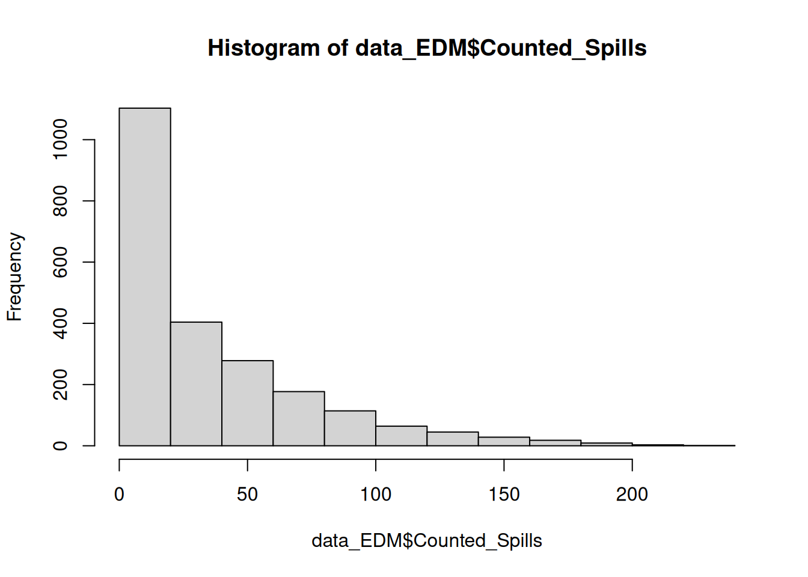

# (PART) Week 3 {-}

# Introduction {#intro_wk3}

## Prepare a new script

Starting today, the first thing you'll do at the beginning of each R practical is:

1. Open a new R script.
2. Save it under a sensible name (e.g. for today, something like `Week3Practical_Water`)
3. Add in a header to explain what the script is
4. Add in the code to load our three main packages/libraries
5. Run the code the load the libraries

For points 3 and 4, the easiest thing is to open your script from last week, copy and paste the relevant content, and then change the information that needs to be updated (e.g. the date and the practical number/theme in the header).

::: {.rmdcaution}
***Caution!***

As you work, make sure that you are adding in:

- Spaces between your variables, operators, functions, and arguments
    - **Good:** `data <- read.csv("file.csv")`
    - **Bad:** `data<-read.csv("file.csv")`)
- Extra line spaces between separate sections of related code.

This will make your code much easier to read and debug.

Starting today, **we will not help you with your code until it is properly spaced**.
:::

::: {.rmdtip}
***Tip!***

Speaking of spaces, it's a good idea to avoid putting spaces in file names.

Try to get in the habit of using underscores or hyphens instead - like we do in the data files and example scripts.
:::

## The water data

Today's dataset is [Event Duration Monitoring - Storm Overflows - Annual Returns](https://www.data.gov.uk/dataset/19f6064d-7356-466f-844e-d20ea10ae9fd/event-duration-monitoring-storm-overflows-annual-returns) from United Utilities in 2024. 

**"Event Duration Monitor" (EDM) data** are records of when untreated sewage is being discharged into waterways. Starting in 2018-2020, the UK government began requiring all water utilities in England to [collect these data in real time every 2 minutes](https://www.gov.uk/government/publications/water-companies-environmental-permits-for-storm-overflows-and-emergency-overflows/water-companies-environmental-permits-for-storm-overflows-and-emergency-overflows#event-duration-monitoring-edm). The government allows for some amount of untreated sewage discharge during periods of high rainfall. However "dry spills" (i.e. discharge that occur when it is not raining) are considered "unsatisfactory". 

You can find live-updating maps of EDM data on websites hosted by [The Rivers Trust ](https://theriverstrust.org/sewage-map), [Surfers Against Sewage](https://www.sas.org.uk/sewage-map/), and [a researcher at UCL named Dr Alex Lipp](https://www.sewagemap.co.uk/). (Feel free to use these links and take a few minutes to check out the current sewage status of the Lune river in Lancaster or your own hometown.)

Annual summaries of EDM data must be submitted to the [Environment Agency](https://www.gov.uk/government/organisations/environment-agency), the government agency in charge of protecting and enhancing the environment in England.


### Download and upload the data

Download today's dataset (`"UU_EDM_2024_Storm_Overflow_4101.csv"`) from the week 3 Moodle page.

Upload the file to the R server and move it into your data folder. 

### Read in the data

Find the code to load data from a .csv file in your script from last week. (Hint: it uses the `read.csv()` function.)

Copy and paste it into this week's script.

You will need to change two things before you run the code:

1. The name of the data frame you are using to store the data (I suggest something like `data_EDM`).
2. The name of the csv file.

Once you run the code, you should see the data frame in your Environment tab. Notice how many observations (= rows) it has!

Use the `str()` function to examine the data frame.

**NOTE:** you will need to substitute `mydf` with whatever you named your data frame.

```
str(mydf)
```

::: {.rmdquestion}
***Questions:***

Make sure that you can answer the following:

- What are all of the variables?
- What do they mean?
- What are their units?
:::

If you are curious about what counts as a "spill", you can read more about the [12/24 counting method here](https://www.gov.uk/government/publications/water-companies-environmental-permits-for-storm-overflows-and-emergency-overflows/water-companies-environmental-permits-for-storm-overflows-and-emergency-overflows#counting-spills).

::: {.rmdtip}
***Tip!***

We could have done week 2's analysis in Excel without too much difficulty (although the figures would not have looked as nice).

However, this week's dataset would be difficult to analyse in Excel because of its large size.

This is one example of why R and other coding-based analyses are so useful.  
:::

## Today's research questions

We will explore the EDM dataset and use it to try to answer the following research questions:

::: {.rmdquestion}
***Research Questions:***

1. How does the frequency and duration of sewage spills in the Lune river in Lancaster compare to the rest of the United Utilities area?

2. How does the frequency and duration of sewage spills in the Lune river in Lancaster in 2024 compare to its long-term average (2020-2024)? 
:::

We will also compare column plots and boxplots and see which type of graph is most helpful for visualising the water data.


# Data processing and exploration


## Converting units

Hopefully, you noticed that the total duration of spills for each site is calculated in seconds. It would be much more intuitive to be able to analyse that variable in hours.

You can create a new column with data from a calculation using existing columns.

- You simply need to use the `<-` operator to create the new column, like you would with any new variable (e.g. `a <- 3`).
- Any maths calculation that R can do on a single number, it can also do on a vector or data frame column (in fact, a data frame column _is_ just a plain old vector in a funny hat).

::: {.rmdtip}
***Tip!*** Remember that you can refer to columns in a data frame using the `$`, and use the autocomplete menu to select from existing columns.
:::

There are 3600 seconds in one hour. Therefore, to convert the total spill duration from seconds to hours, you will need to divide the data in the old column by 3600.

Use the code below as a template.

**NOTE:** you will need to substitute `mydf` and the column names with the names of your data frame and column names.

```r
# Convert spill duration units from secs to fractional hours
mydf$new_column_hours <- mydf$old_column_secs / 3600
```

## Visualising data with histograms

For a single variable, histograms plot the values of that variable on the x-axis and the the frequency that each value is observed on the y-axis. The values are grouped into "bins", e.g.

- 0 ≤ x ≤ 5
- 5 < x ≤ 10
- 10 < x ≤ 15
- etc.

Histograms are a great way to visualise data to help you understand the most common values and the spread of a variable.

You can make nice, fancy looking histograms with the `ggplot()` function. However, here we will use the base R `hist()` function because we just want to see the data - not put it in a report.

The code below makes a histogram of the `Counted_Spills` column.

Type it into your script, then add three more lines of code to make histograms for the following additional variables:

- long-term spill average
- spill duration
- percent of time operational

Run all four lines to examine the data.


``` r
hist(data_EDM$Counted_Spills)
```



::: {.rmdtip}
***Tips:***

1. You can navigate back and forth through different plots that you've made in the `Plots` pane using the back and forward errors in the top left corner.

2. R will automatically add the name of the data frame and column as the histogram title, so you can see which data each plot belongs to.

:::

Use the histograms to answer the following questions.

::: {.rmdquestion}
***Questions:***

1. For each of the four variables, what is the most commonly observed value (or bin of values)?

2. For each of the four variables, what is the largest observed value (or bin of values)?

3. Do all the variables have the same general shape? Which variables have the longest tails? (i.e. values that stretch out the most to the right or left away from the most common values?)

4. How does the number of spills in 2024 compare to the long-term average?
:::

## Logical comparisons in R

Most programming languages (including R) use a standard set of operators to compare values.

These comparisons or tests will output something called a "boolean" value that is either `TRUE` or `FALSE`.

- `x == y` tests if x and y are equal
- `x != y` tests if x and y are **not** equal
- `x < y` tests if x is less than y
- `x > y` tests if x is greater than y
- `x <= y` tests if x is less than or equal to y
- `x >= y` tests if x is greater than or equal to y

Type out the following code below and run it line by line while looking at the output in your console.

Make sure that you understand how each line is working.

```r
1 == 2
1 != 2
1 < 2

# Create a vector
test_vec <- c(1, 2, 3, 4, 5)

test_vec == 3
test_vec != 3
test_vec < 3
test_vec > 3
test_vec <= 3
test_vec >= 3
```

R also has another operator that can be used to determine if a specific value is found within a vector: `%in%`. 

In the next section, we'll show you how the `%in%` operator can be really useful.

For now, type and run the code below to show yourself how it works.

```r
3 %in% test_vec
6 %in% test_vec
```

## Filtering data

I used one of the sewage monitoring websites (linked in the {#intro_wk3}) to find the unique site IDs for the 9 United Utilities discharge sites that are located within central Lancaster and discharge in the Lune River:

- UUP00360
- UUP01608
- UUP01494
- UUP01211
- UUP00603
- UUP00604
- UUP00387
- UUP02160
- UUP01686

If you want to be able to easily extract the rows of data from these cites, the first step is to create a vector with these site IDs.

Type and run the code below to create this vector.

```r
# Create vector of unique IDs for discharge sites in central Lancaster
EDM_vec <- c("UUP00360", "UUP01608", "UUP01494", "UUP01211", "UUP00603", "UUP00604", "UUP00387", "UUP02160", "UUP01686")

```
::: {.rmdtip}
***Tip!*** Remember that each element in a vector must be separate by a comma!
:::

::: {.rmdquestion}
***Question:*** Why are each of the site IDs given in quotation marks?
:::

Now that we have our vector of site IDs, we can use the `%in%` operator to filter for only the rows that match one of the elements in the vector.

We will use the `filter()` function, as shown below. This code:

- creates a new data frame called `data_EDM_LA`...
- using our original dataset (which I called `data_EDM`), which is piped into...
- the `filter()` function, which is given the arguments to select rows with `unique_ID` values that match an element in our vector `EDM_vec`

Type and run the code below. Make sure you understand what it is doing before you move on. 

```r
# Filter list by site unique ID - only central Lancaster sites
data_EDM_LA <- data_EDM |>
  filter(Unique_ID %in% EDM_vec)
```

::: {.rmdtip}
***Tip!*** Although we are using `%in%` for the `filter()` function here, you can also use any of the logical comparison operators (e.g. `==`, `!=`, `>`, `<`, etc.) to filter your data.
:::

For our comparison, we will also want to make a list that has all of the rows **except** those located in central Lancaster.

We can use very similar code - except this time we will add a `!()` nested within our `filter()` function. This will negate the selection (i.e. make all `FALSE` values into `TRUE` and vice versa), which will make it select all the rows that _do not_ match any of the values in the vector, rather than those that _do_ match one of the values. 

```r
# Filter list by site unique ID - excluding central Lancaster sites
data_EDM_rest <- data_EDM |>
  filter(!(Unique_ID %in% EDM_vec))
```


## Adding a location column

For the graphing that we want to do later, we will want to be able to tell R to use site location (i.e. central Lancaster or not) as a data grouping variable.

Therefore, it will be very helpful if we can add a location column to our two separate datasets and then add them back together into one data frame.

::: {.rmdtip}
***Tip!*** If you want to add a new column where every row has the same value (or change the values in an existing column to all have the same value), you can provide that value once and R will duplicate it for every row.
:::

The code below will create a new column called `location` with the value `"Lancaster"` or `"Non-Lancaster"`. 

**NOTE:** You will need to change the data frame `mydf` to the correct names of your data frames for the Lancaster and non-Lancaster data, as appropriate.

```r
mydf$location <- "Lancaster"
mydf$location <- "Non-Lancaster"
``` 

## Combining data frames

You can combine data frames using the `rbind()` function (it stands for "row bind").

::: {.rmdwarning}
***Warning!*** The `rbind()` function will only work if both of your data frames have the same number of columns - otherwise you will get an error.
:::

Type and run the code below to combine the two data frames.

```r
data_EDM_all <- rbind(data_EDM_LA, data_EDM_rest)
```


# Summary statistics with dplyr


There is a function in the `dplyr` package called `summarise()` that is very useful for calculating summary statistics, particularly on multiple groupings of data (also called "subsets").

`summarise()` will perform any calculation that you tell it to on your dataset. Today, we'll use it to calculate the median - using the `median()` function. However, it can also calculate means, standard errors, or any mathematical formula that you can express as code in R.

- We are using medians instead of means because all of the data are very skewed to one direction! Means are only appropriate when the data look something like the symmetrical, hump-shape shown below (called a Normal distribution).

<div style="text-align: center;">

{width=100%}

</div>


To tell R to subset the data by location (i.e. Lancaster vs. non-Lancaster), we'll include another function first: `group_by()`. This will tell `summarise()` to do the calculates separately for each location. 

When we calculate summary statistics with `summarise()`, we'll want to save the output as a new data frame and pipe in the data frame with all of the original observations.

Afterwards, we can either examine the output by clicking on it in our Environment pane, or by printing it to the console with the `print()` function as shown here.

Type the following code in your script and run it.

::: {.rmdtip}
***Important!***

Note in the code block below that you are using the pipe operator (|>) to continually pass versions of a data frame down from the top through different functions in a vertical stack.

This is a common way that tidyverse R code (i.e. code from the `dplyr`, `tidyr`, and ``ggplot2` packages) is written. 
:::


``` r
# Calculate the medians by location
EDM_summary <- data_EDM_all |>
  group_by(location) |>
  summarise(median_counted_spills = median(Counted_Spills))
print(EDM_summary)
#> # A tibble: 2 × 2
#>   location      median_counted_spills
#>   <chr>                         <int>
#> 1 Lancaster                        NA
#> 2 Non-Lancaster                    NA
```

::: {.rmdquestion}
***Question:*** Do you notice anything unexpected about the data?
:::


## Removing NAs

The results above show `NA` instead of the median values we expected.

`NA` stands for "Not available" and means that there are missing values in our data. 

Luckily there is an argument - `na.rm = TRUE` - that you can add to the `median()` function to make it ignore any missing values.

Add the argument now and re-run the code.

::: {.rmdwarning}
***Warning!*** Remember that you need to add include a comma between every argument that you give a function!
:::

## Adding the other variables

Once you have your code working to calculate the median for the counted spills column, add additional `median_x = median(x)` arguments to the `summarise()` function to calculate the median values for the other three variables:

- long-term spill average
- spill duration
- percent of time operational

::: {.rmdwarning}
***Warning!***

Make sure you add the new median arguments inside the right set of brackets! They each need to be:

- inside the `summarise()` function
- outside the previous `median()` function 
:::

By the end, you should have an `EDM_summary` data frame that looks something like this (but yours will display all four variables instead of cutting off because it's too wide for the webpage):


```
#> # A tibble: 2 × 5
#>   location      median_counted_spills median_LTA_spill_count
#>   <chr>                         <dbl>                  <dbl>
#> 1 Lancaster                       9.5                   19.6
#> 2 Non-Lancaster                  21                     29  
#> # ℹ 2 more variables: median_spills_dur_hrs <dbl>,
#> #   median_perc_time_operational <dbl>
```
## Answering the research questions

Now that you have your summarised data output, you should be able to answer our research questions from the beginning.

::: {.rmdquestion}
***Research Questions:***

1. How does the frequency and duration of sewage spills in the Lune river in Lancaster compare to the rest of the United Utilities area?

2. How does the frequency and duration of sewage spills in the Lune river in Lancaster in 2024 compare to its long-term average (2020-2024)? 
:::


# Making graphs


We've answered our research questions with the table, but it would be nice to be able to make some plots to illustrate the numbers visually.

Last week you used the `ggplot()` function to make a line graph of the yield of three cereal crops over time. 

This week we'll make two types of graphs - boxplots and column plots.

- Both types of graph will compare the Lancaster sites to the non-Lancaster sites.

Let's start with the counted spills variable.


## A `ggplot()` template

Here is a template that you can use as a basic template to make graphs with `ggplot()`.

This is the same format of code that you used last week, except for the additional `theme()` function at the end to change the font size of the axis titles and tick mark text.


```r
my_fig <- mydf |>
  ggplot(aes(x = my_x_var, y = my_y_var)) +
  geom_mygraphtype() +
  labs(x = "X axis label (units) ", y = "Y axis label (units)") +
  theme_bw() +
  theme(axis.title = element_text(size = 14),
        axis.text = element_text(size = 11))

print(my_fig)
```

In order to adapt this code template, you will _need_ to change, at minimum:

- the name of the data frame
- the name of the x and y variables in the `aes()`
- the geom_mygraphtype() function

You will also want to change the axis labels so that they match the data (and probably want to change the name of the figure object too).

The two `geom` functions that you will need for today's graphs are:

- `geom_boxplot()`
- `geom_col()`

Start with the boxplot first. Then once you get it working, move on to the column plot.

::: {.rmdtip}
***Important!***

The two different types of graph need different types of data:

- The **boxplot** will need the original data set that contains the values for all of the sites. 
- The **column plot** will need medians from the summarised data.

This means that that your data frame and your x and y variables will be different for each type of graph.

You can always check the column names of your data frames by using `head()` or `str()` in the console, or by using the Environment pane.
:::


## Adding colours

Try to change the colours of your graphs. 

Choose a colour that you like either using [named colours](https://derekogle.com/NCGraphing/resources/colors) or [hexadecimal codes](https://streamlinepublishing.com/inside-art/who-put-the-hex-on-color/).

Then add your colour argument (e.g. `fill = "#66CCEE"` or `fill = "aquamarine3"`) to the `geom_boxplot()` or `geom_col()` arguments. 


## Graphs for additional variables

Depending on the time remaining, you should try to make boxplots and column plots for the other three variables as well:

- long-term spill average
- spill duration
- percent of time operational

You will need to change the y variable and y-axis label. 


# Tidying up {#tidyup_wk3}

Now it's time to tidy up and save your R script. 

As always, you will want to:

- Make sure that your code is sufficiently commented, so that someone else (or you later on!) can understand what you did.
- Delete any spare lines of code that you don't need anymore (e.g. for testing something that didn't work right away).

## Creating an R dictionary

I **strongly** recommend creating a set of notes where you keep track of all the bits and bobs of R that you've learned.

The easiest way to do this is as a markdown (i.e. text) file - this will allow you to edit it and view it in RStudio, and make it more effective coding tool. 

You can create a markdown file by going to: File > New File > Markdown (at the top of the 6th section down).

Here is a list of all the key functions that we've learned over the past two weeks, grouped by type and then in alphabetical order.

You can copy and paste this list into your markdown file, and then add your own annotations / descriptions that will help you remember how they work. 


### General / data analysis

- filter()
- group_by()
- head()
- library()
- median()
- pivot_longer()
- print()
- rbind()
- read.csv()
- str()
- summarise()
- tail()
- View()

### ggplot functions

- aes()
- ggplot()
- ggsave()
- geom_boxplot()
- geom_col()
- geom_line()
- labs()
- theme()
- theme_bw()

## Other plotting functions

- hist()


