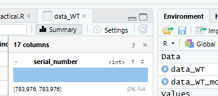
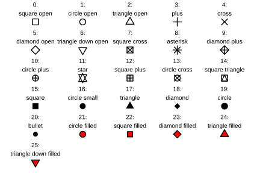

# (PART) Week 4 - Wind turbine data in R {-}

# Introduction {#intro_wk4}

## Prepare a new script

As usual, you will want to start today's practical with the following steps:

1. Open a new R script.
2. Save it under a sensible name (e.g. for today, something like `Week4Practical_Climate`).
3. Add in a commented header to explain what the script is.
4. Add in the code to load our three main packages/libraries (`dplyr`, `tidyr`, and `ggplot`).
5. Run the code the load the libraries.

::: {.rmdtip}
***Tip!***
Remember, for items 3 and 4 the easiest thing is to open your script from last week, copy and paste the relevant content, and then change the information that needs to be updated (e.g. the date and the practical number/theme in the header).
:::

## Load two additional packages

Today we will be using two new packages in addition to those that we've been using for the past two weeks. They are:

- `lubridate` - a package for working with dates
- `patchwork` - a package for creating multi-panel figures

They are already installed on the LEC R server, so all you need to do is load them with the `library()` function.

::: {.rmdtip}
***Tip!***

Remember to actually run the lines of code where you load the new packages! Having the lines of code in your script is not enough.

This was a common mistake from last week.
:::

## The climate data

Today's dataset is energy production data from the Lancaster University wind turbine. This data was kindly provided to us by [Dr Sergio Campobasso](https://www.lancaster.ac.uk/lira/people/sergio-campobasso) in LU's School of Engineering.

The 2.35 megawatt (MW) turbine provides [approximately 14% of the Bailrigg campus's electricity annually](https://www.lancaster.ac.uk/news/net-zero-on-the-horizon-for-lancaster-university-thanks-to-renewable-energy-investment) and is a key part of Lancaster University's net zero strategy. Combined with the new 11 MW solar farm and a system of heatpumps, the Bailrigg campus now regularly generates 100% of its energy usage. 

### Download and upload the data

Download today's dataset (`"LU_wind_turbine_data_2025_thin.csv"`) from the week 4 Moodle page.

Upload the file to the R server and move it into your data folder. 

### Read in the data

Read in the data from the csv file.

If you use the code from a previous week, you will need to change two things: 

1. the name of the data frame you are using to store the data (I suggest something like `data_WT`)
2. the name of the csv file.

Once you run the code, you should see the data frame in your Environment tab. Notice how many observations (rows) and variables (columns) it has!

Just like last week's sewage overflow data, this week's data would be difficult to analyse in Excel because of its large size.

Use one of the methods you've learned previously to examine the data frame.

::: {.rmdtip}
***Tip!***

Another nice way to examine a data frame is to use the function `names()` or `colnames()` with your data frame as the argument.

Both of these functions will give you the column names of your data frame.
:::

::: {.rmdquestion}
***Questions:***

Try to answer the following questions. (The information below may help.)

- What are all of the variables?
- What do they mean?
- What are their units?
- How frequently are the measurements taken?
:::

A **rotor** is the rotating part of any machine, including wind turbines. 

A wind turbine **nacelle** is the compartment behind the rotor that houses the systems that convert the rotation into usable power.

**Reactive power** is a fundamental part of AC (alternating current) electricity. It oscillates back and forth and cannot be used to do useful work. However, it is very important for maintaining a wind turbine's connection to the grid and the overall stability of the grid. 

<div style="text-align: center;">

{width=100%}

</div>
[Photo credit: Paul Anderson](https://commons.wikimedia.org/wiki/File:Nacelle_of_Turbine_Tower_No_26_-_geograph.org.uk_-_824692.jpg)

**Note:** The dataset appears to have measurements collected over 2 hour periods. The original dataset from Dr. Campobasso had measurements every 10 minutes, but it was extremely large (almost 200,000 rows) and kept crashing the R server session during my testing. I've provided you with every 12th row from the original dataset. Thus, the means, minimums, and maximums in the data are still for 10 minute periods of time, but you only have the observations collected every 2 hours.

## Today's research questions

We will explore the wind turbine dataset and use it to try to answer the following research questions:

::: {.rmdquestion}
***Research Questions:***

1. In 2025, What was the relationship between the amount of power generated and:
  - wind speed?
  - rotor speed?
  - nacelle position?

2. In 2025, did certain directions tend to have stronger winds that were better at generating power than others?

3. In 2025, did certain months have faster winds that were better at generating power than others?
:::

# Data processing and exploration {#dataprocessing_wk4}

## Indexing

_Indexing_ is a way to refer to different parts of a data object. 

In R, indices (the plural of "index") are provided in square brackets `[]`.

For example, if we take a vector, we can refer to specific elements within it.

Type the code below into your script and run the lines of code.

Make sure that you understand why each line produces the output it does. 

```r
test <- c(2, 4, 8, 16, 32)
test[1]
test[5]
test[3:5]
test[c(2,4)]
```

### Indexing in two dimensions

The previous example showed how to index in a one-dimensional vector.

You can also index in two-dimensional data structures like data frames. 

For two-dimensional data (like data frames) indexing in R uses a comma, with the row(s) coming before the comma and the column(s) coming after: `[row, column]`

::: {.rmdtip}
***Tip!***

If you leave a blank space either before or after the comma, R will interpret that as "all of them".

So `mydf[ , 3:4]` will give you columns 3 and 4 for _all_ rows, whilst `mydf[5:10, ]` will give you _all_ the columns for rows 5 through 10.
:::

Once again, type the code below into your script and run the lines of code. (**NOTE**: You will have to change `mydf` to match whatever you called the wind turbine dataset.)

Make sure that you understand why each line produces the output it does. 

```r
mydf[100:110, ]
mydf[100:110, 2]
mydf[100:110, 14:16]
test <- c(1, 3, 4, 6)
mydf[100:110, test]
```

## Selecting columns

This dataset has a lot of columns that we won't need to use in today's practical.

For example, for most of the variables it provides a minimum, a mean, and a maximum. (Also, I'm still not sure I understand what reactive power means, even after watching some YouTube videos about it.)

So, let's use indexing to select just the columns that are most relevant to our research questions. These are:

- The date and time
- The mean windspeed (mps)
- The mean rotor speed (rpm)
- The mean power production (kw)
- The nacelle position (degree)

First, you will need to create a vector (`col_nums`) with the column numbers for only the columns you want to keep.

Test it on the list of column names to make sure you've chosen the correct numbers before proceeding. 

```r
# Create a vector with the desired column numbers
col_nums <- c(2, 3, ...)

# Check the column names to make sure they are correct
names(data_WT)[col_nums]
```

Once you're sure you have the correct column numbers, you can rewrite the data frame to only include all rows, but only those specific columns.

::: {.rmdtip}
***Tip!*** Rewriting the new data frame over our original data frame is okay in this case, because we can always reload from the original csv file if we make a mistake in selecting columns.
:::

```r
# Use indexing to select just the columns we want
mydf <- mydf[ , col_nums]
```

## Explore the data

Now that we've reduced the number of variables in our data frame, use the `hist()` function to take a look at the distributions of the six remaining variables. 

```r
hist(mydf$mycol1)
hist(mydf$mycol2)
```

::: {.rmdtip}
***Tip!***

You can also get a quick preview of all your variables at once by clicking on the data frame in your Environment tab and looking at the Summary panel that pops up.
:::

<div style="text-align: center;">


</div>

## Convert datetime column to date format

Take a closer look at the `datetime` column in your Environment pane or using the `str()` function.

::: {.rmdquestion}
***Question:*** What type of data is it? 
:::

### Data types and dates

So far we've mostly talked about three different types of data:

- **integer** - i.e. whole numbers
- **numeric** - a number with at least one decimal place, even if it's zero
- **character** - text, which is always put in ""

However there are other types of data that sort of fall in between the two.

Unlike numeric data, normal character data can't have any maths performed upon it. However the following makes complete sense:

> 2026-10-27 + 4 days = 2026-10-31

So there should probably be a specific form of data for holding dates. This is indeed the case!

Excel is notoriously bad at dealing with dates. It can automatically convert numbers to dates when you don't want it to, or refuse to format the lovely dates that you have in the way that you wish.

In fact, there is an entire sub-genre of memes on the topic.

<div style="text-align: center;">

{width=100%}
</div>

<div style="text-align: center;">

{width=100%}
</div>

<div style="text-align: center;">


</div>

This is not entirely the fault of excel. Dates are _actually_ quite hard to deal with!

For example the date 04-08-02 is obviously the 4th of August 2002, unless you are American in which case it is naturally the 8th of April 2002. How is the computer meant to know your nationality? 

Is the date 29/02/2026 valid? Why (to the computer) would that be different to 29/02/1992?

This is another area where R excels over Excel (pun intended).

R has a data type specifically made for dates, and a package - `lubridate` - that is designed to help you manipulate this type of data.

## Converting character data to dates with `lubridate`

The `lubridate` package has a bunch of related functions to convert character data to dates. Each one tells R exactly where to expect the day, month, and year, and possibly hours, minutes, and seconds if there is a time provided as well.

These functions are:

- `ymd_hms()`
- `ymd_hm()`
- `ymd_h()`
- `ymd()`
- `ydm_hms()`
- `ydm_hm()`
- `ydm_h()`
- `ydm()`
- `dmy_hms()`
- `dmy_hm()`
- `dmy_h()`
- `dmy()`
- `mdy_hms()`
- `mdy_hm()`
- `mdy_h()`
- `mdy()`

You can probably guess what each of these different variants is used for, but if you want to see the documentation you can run this `?dmy_hm` in the console and R will open the help file. 

It's hard to tell from the start of the wind turbine dataset (i.e. "01/01/2022 00:00") whether the data are in month-day-year or day-month-year.

Either scroll down or use indexing to find a date where it's more obvious whether the day or month comes first.

**Hint**: Try using indexing to look at the value in row 700.

```r
mydf$mycol[700]
```

Now that you know the date format, you should be able to select an appropriate lubridate function to convert the character-type data to date-type data.

Just as when we were selecting the columns before, we can overwrite the old `datetime` column here, because if we make a mistake we can just re-run our previous code. 

```r
# Convert date column from character to date
mydf$datetime <- xxx_xxx(mydf$datetime)
```

Check the Environment tab or use the `str()` function to make sure the `datetime` column has the correct format now. It should say `POSIXct` (which stands for "[POSIX](https://en.wikipedia.org/wiki/POSIX) calendar time").

### Extract the month into a new column

Now that we have our date in a proper date-type format, we want to extract the month into a new column. This will allow us to calculate summary statistics separately for each calendar month. 

There is a `month()` function in `lubridate` that will return the month value from date-type data.

```r
# Extract the month and put it in a new column
mydf$month <- month(mydf$datetime)
```

# Plots of the raw data

Now let's look at some plots of the raw data.

You can use the template below (you will need to change the data frame and variable names).

These graphs use the function `geom_point()` to add a layer of points at x-y coordinates (e.g. an x-y scatter plot).

- The `alpha = 0.1` argument controls the transparency of the point, where 0 is completely transparent and 1 is completely opaque. When you have _lots_ of data points, making the points transparent can help you see where there are lots of points vs. just a few.
- The `shape = 16` argument changes the shape according to the options shown below (I think the close, small circle works better for this many points, but you can try some different shapes and see for yourself).
- You can also change the size with a `size = x` argument if you'd like. 

<div style="text-align: center;">

{width=100%}
</div>

```r
myfig <- mydf |>
  ggplot(aes(x = my_x_var, y = my_y_var)) + 
  geom_point(alpha = 0.1, shape = 16) + 
  theme_bw()
print(myfig)
```

::: {.rmdwarning}
***Warning!***

Be careful where you put the arguments `alpha` and `shape`. If you're not careful and end up putting them in an `aes()` call, you could run into problems.

Best case scenario your code will throw an error.

Worst case it is actually valid and you don't notice that it's not what you wanted.
:::

Make five plots showing:

- power vs. datetime (this is important to look for gaps and make sure we have good data coverage over the year)
- power vs. wind speed
- power vs. rotor speed
- power vs. nacelle position
- wind speed vs. nacelle position

::: {.rmdwarning}
***Warning!***

You'll want to think carefully about which variable goes on the x-axis and which variable goes on the y-axis.

Generally speaking you want the x-variable to be the thing causing a change in the y-variable. 
:::

## Adding trendlines with `ggplot()`

For x-y scatter plots, you may want to add a trendline. 

With `ggplot()`, the way to do it is by adding a layer to your plot with the `geom_smooth()` function. 

::: {.rmdtip}
***Tip!***

The order in which you add your layers matters!

You probably want to add your `geom_smooth()` layer after your `geom_point()` layer, so it will be on top of the points instead of underneath them.
:::

There are three automated methods that `geom_smooth()` can use for the trendline. (You can also give it your own formula, but we won't cover that in this module.)

- a linear trendline: `geom_smooth(method = "lm")`
- a gam trendline: `geom_smooth(method = "gam")`
- a loess trendline:`geom_smooth(method = "loess")`

The latter two are two different ways to fit a smooth curve to data. (The specific math is _way_ beyond the scope of this module - we'll just be looking at both of them visually.)

Add a trendline to each of yours plots, and experiment to see which method of trendline appears to fit the data best. 

::: {.rmdquestion}
***Question:*** Which method of trendline appears to work best for each plot?  
:::

We're now at the point where you can answer questions 1 & 2!

::: {.rmdquestion}
***Research Questions:***

1. In 2025, What was the relationship between the amount of power generated and:

  - wind speed?
  - rotor speed?
  - nacelle position?

2. In 2025, did certain directions tend to have stronger winds that were better at generating power than others?

<span style="opacity: 0.4;">3. In 2025, did certain months have faster winds that were better at generating power than others?</span>
:::


# Monthly data summaries and multipanel figures with `patchwork`

## Summarising data by month

Our last question involved looking at monthly patterns in wind and energy generation.

This means that we'll need to calculate means or medians for each month. 

Just like with the EDM sewage overflow data last week, [the data are not very symmetrical](https://mshocket.github.io/LECFoundationsBookdown/summary-statistics-with-dplyr.html), so medians are more appropriate than means.

The code to calculate medians in the EDM data is provided below (without the `na.rm = TRUE` arguments as the wind turbine data do not have any `NA` values).

Remember what the code did:

- Saved the output as `WD_summary`
- Used the data `frame data_EMD_all` in the calculations
- Grouped the data by the `location` column values (either `Lancaster` or `Non-Lancaster`)
- Calculated the median values for each group for the three columns: `Counted_Spills`, `Long_term_Average_Spill_Count`, and `Total_Spills_Duration_hours`

```r
WD_summary <- data_EMD_all |>
  group_by(location) |>
  summarise(median_counted_spills = median(Counted_Spills),
            median_LTA_spill_count = median(Long_term_Average_Spill_Count),
            median_spills_dur_hrs = median(Total_Spills_Duration_hours))
```

Modify it to calculate medians for three of the variables (wind speed, rotor speed, and mean power) grouped by month.


## Creating column plots

Once you have your monthly median values, make a column plot for each of the three variables.

::: {.rmdtip}
***Tip!***

Sometimes we create multiple figures in a row with the same name (e.g. `fig`) out of convenience. 

In this case, you will want to store them all with unique object names (e.g. `fig_windspeed` etc.), because we will want to refer to them later.
:::

Use one of your previous `ggplot()` graphs as a template, or use the template [here](https://mshocket.github.io/LECFoundationsBookdown/making-graphs.html).

Remember from last week that the function for add a column plot layer is `geom_col()`.


### Changing the x-axis tick mark labels

It makes sense to keep month as a numeric data type for plotting - if they were labled with month names as characters, R would try to plot them in alphabetical order by default!

However, for the graphs, we might want to change the axis tick mark labels to have months names instead of numbers, because month 7.5 doesn't really make sense.

You can do that by adding a new layer with the `scale_x_continuous()` function. It takes two arguments:

- `breaks` - which x-axis values to put the labels at
- `labels` - what the actual labels should be

In this case, you probably want to add labels for January, June, and December, which correspond to months 1, 6, and 12.

You'll need to provide those values to the arugments as vectors.

::: {.rmdtip}
***Tips!*** Remember:

- To create your own vector, use a small c and separate each value with a comma.

- Any text values must be in quotation marks.
:::

### Adding colours

Try to change the colours of each of your graphs.

You could:

- Choose a colour palette from [this website](https://coolors.co/palettes/trending) and provide the hexadecimal codes for colours that go well together.
- Use [named colours](https://derekogle.com/NCGraphing/resources/colors).
- Pick your own [hexadecimal codes](https://streamlinepublishing.com/inside-art/who-put-the-hex-on-color/).

Remember, add your colour argument (e.g. `fill = "#66CCEE"` or `fill = "aquamarine3"`) to the `geom_col()` arguments. 


## Combining plots with patchwork

The `patchwork` package lets you combine `ggplot()` plots into multi-panel figures.

- Put plots next to each other with `|`
- Put plots underneath each other with `/`
- Group plots together with brackets `()`

For example, two panels side-by-side:

```r
 fig1 | fig2
```

Or two panels above and below:

```r
 fig1 / fig2
```

Or two panels above and one below

```r
 (fig1 | fig2) / fig3
```

You can also change the relative width and height of different rows and columns in your combined figure as shown below:

```r
fig1 | fig2 + plot_layout(widths = c(1, 2))
```

```r
 (fig1 | fig2) / fig3 + plot_layout(heights = c(1, 2))
```

Try combining your three column plots into a single figure in a few different ways.

::: {.rmdquestion}
***Questions:*** 

- In 2025, did certain months have faster winds that were better at generating power than others?
- Given your final plots, do you think a national energy strategy based only on expanding wind power is feasible? Why/why not?
- Do you think that the solar farm on campus would have a similar monthly power plot? Why/why not?

:::

# Tidying up {#tidyup_wk4}

Now it's time to tidy up and save your R script. 

As always, you will want to:

- Make sure that your code is sufficiently commented, so that someone else (or you later on!) can understand what you did.
- Delete any spare lines of code that you don't need anymore (e.g. for testing something that didn't work right away).

## Creating your own R cheatsheet

If you didn't get this far last week, I **strongly** recommend creating a set of notes where you keep track of all the bits and bobs of R that you've learned.

The easiest way to do this is as a [markdown](https://www.markdownguide.org/basic-syntax/) (i.e. text) file - this will allow you to edit it and view it in RStudio, and make it more effective coding tool.

You can create a markdown file by going to: File > New File > Markdown (at the top of the 6th section down).

Last week, I listed out all of the funtions that we used in the first two practicals, grouped by type and then in alphabetical order [here](https://mshocket.github.io/LECFoundationsBookdown/tidyup_wk3.html).

You can copy and paste this list into your markdown file, and then add your own annotations / descriptions that will help you remember how they work.

Remember to also add the functions from the last few weeks if you haven't already!

The new functions from this week are:

### General / data analysis

- `[,]` (indexing with square brackets)
- `names()` - works for data frames and named vectors
- `colnames()` - works for data frames
- `month()`
- `ymd_hm()`, `mdy()`, and `dmy()` etc. 

### ggplot functions

- `geom_point()`
- `geom_smooth()`
- `scale_x_continuous()`
