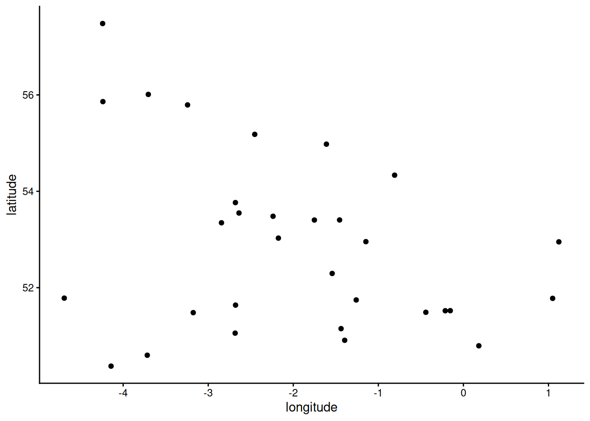
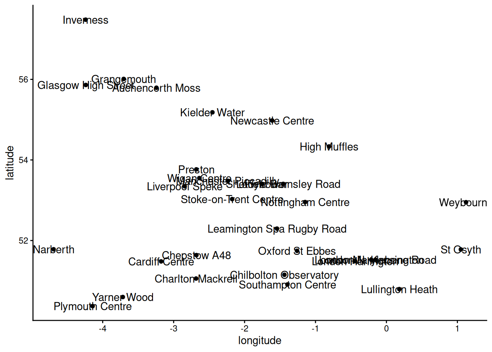
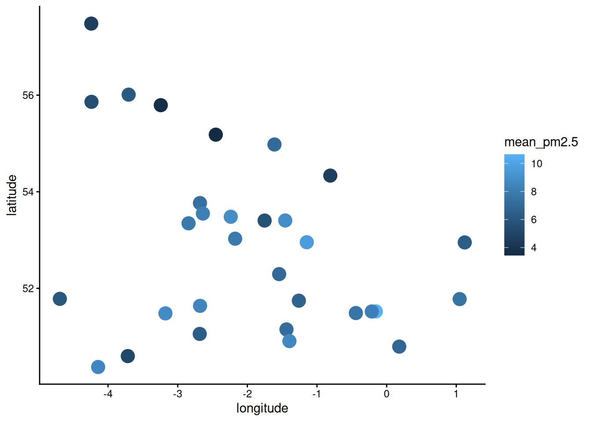
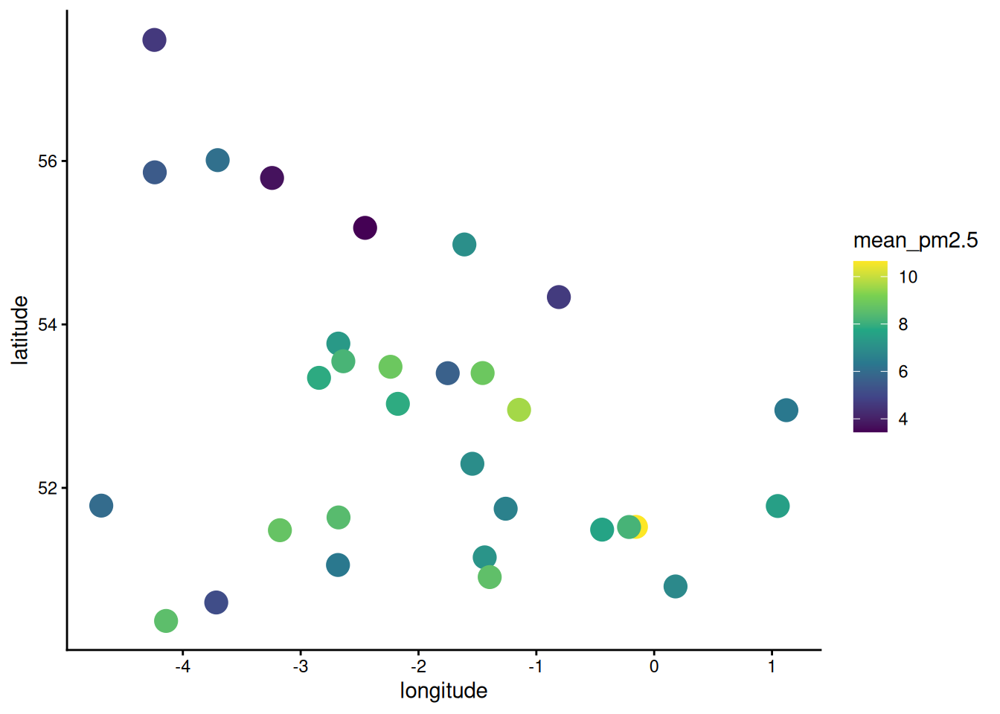
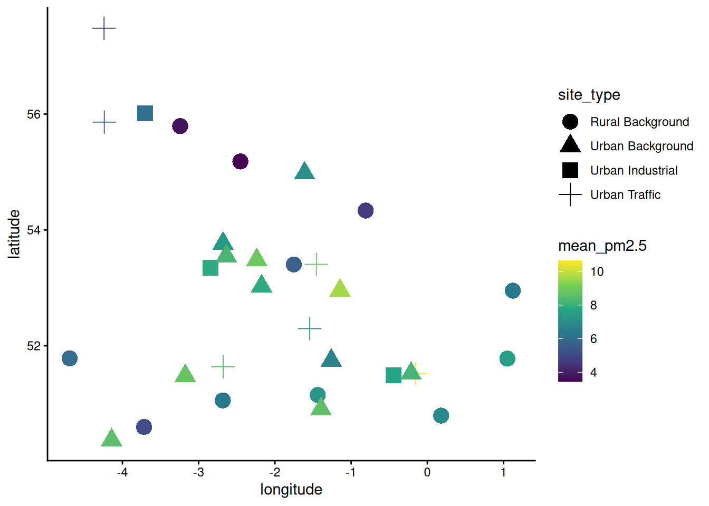
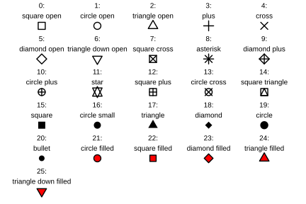
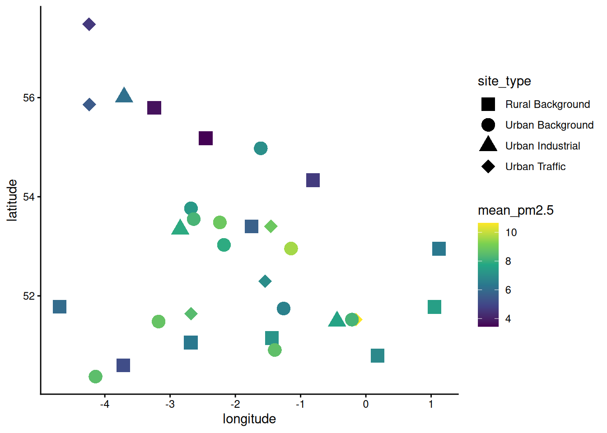
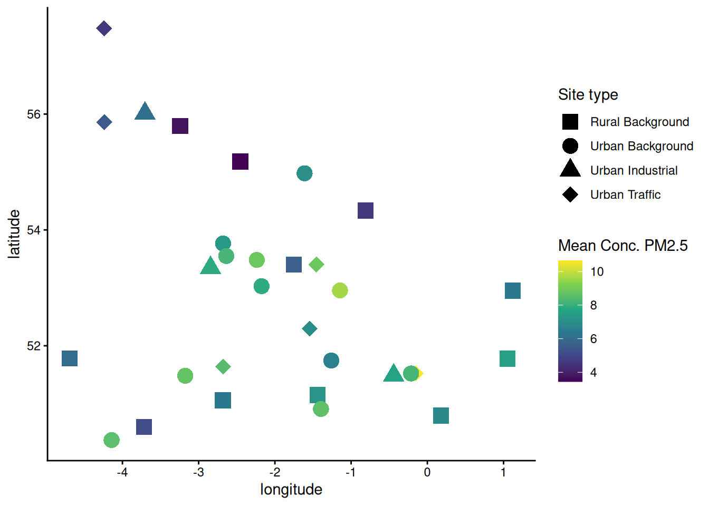

# (PART) Week 5 - Air quality data in R {-}

# Introduction {#intro_wk5}


## Prepare a new script

As usual, you will want to start today's practical with the following steps:

1. Open a new R script.
2. Save it under a sensible name (e.g. for today, something like `Week5Practical_Health`).
3. Add in a commented header to explain what the script is.
4. Add in the code to load our three main packages/libraries (`dplyr`, `tidyr`, and `ggplot`), as well as `lubridate`, which we will also use today.
5. Run the code the load the libraries.

::: {.rmdtip}
***Tip!***
Remember, for items 3 and 4 the easiest thing is to open your script from last week, copy and paste the relevant content, and then change the information that needs to be updated (e.g. the date and the practical number/theme in the header).
:::


## The air quality data

Today's dataset is made available by [Defra, the UK department for Environment, Food & Rural Affairs](https://www.gov.uk/government/organisations/department-for-environment-food-rural-affairs).

The main data portal for UK air quality data can be found at [UK AIR ](https://uk-air.defra.gov.uk/) (the Air Information Resource).

There is also an [R package called `openair`](https://cran.r-project.org/web/packages/openair/index.html) that makes it easy to download UK air quality data directly into R. The work to build and maintain the R package was led by a chemist at York University, [Prof. David Carslaw](https://www.york.ac.uk/chemistry/people/dcarslaw/). An [online book](https://openair-project.github.io/book/) explaining how the package works can be found here.

Although you won't be using the `openair` R package directly (primarily because it's not installed on the LEC R server), this package is how I originally obtained the data that are posted on Moodle for you to download and use.  

Specifically, we will be using data from the [AURN - Automatic urban and rural network](https://uk-air.defra.gov.uk/networks/network-info?view=aurn).

From the AURN website:

> "The AURN is the UK's largest automatic monitoring network and is the main network used for compliance reporting against the Ambient Air Quality Directives. It includes automatic air quality monitoring stations measuring oxides of nitrogen (NOx), sulphur dioxide (SO2), ozone (O3), carbon monoxide (CO) and particles (PM10, PM2.5). These sites provide high resolution hourly information which is communicated rapidly to the public, using a wide range of electronic, media and web platforms."

We will be focusing on **fine particulate matter**, known as $PM_{2.5}$, because it has a diameter of 2.5 microns or less.  It is measured in $µg/m^3$.

$PM_{2.5}$ is the most dangerous size of particle for human health because it can penetrate more deeply into the lungs and even travel through the bloodstream to other organs. $PM_{2.5}$ typically comes from combustion, including motor vehicle exhaust, fossil fuel burning power plants, industrial activities, domestic cooking and heating, waste incineration, and wildfires. 

AURN data are available with averages calculated at at hourly, daily, monthly, and annual time scales. The data you are working today are **hourly data**. 

### Download and upload the data and metadata

Download today's datasets from the week 5 Moodle pag:

- Our main dataset: `"AirQuality_data.csv"`
- The related metadata: `"AirQuality_metadata.csv"`

Upload the files to the R server and move it into your data folder. 

::: {.rmdtip}
***Information:***

**Metadata** is information that defines and describes the characteristics of a dataset.

Metadata often includes more detailed information about sample collection methods, calculations, sample locations, units, etc. 
:::

### Read in the data

Read in the data from the csv files.

If you use the code from a previous week, you will need to change two things: 

1. the names of the data frame you are using to store the data (I suggest something like `data_AQ` and `metadata_AQ`)
2. the names of the csv files.

Once you run the code, you should see the data frame in your Environment tab.

Notice how many observations (rows) and variables (columns) the data and metadata have.

### Examine the data

Use one of the methods you've learned previously to examine the data frames of the data and metadata.

Use the `unique()` function to see what possible values there are for `site_type`.

::: {.rmdquestion}
***Questions:***

Try to answer the following questions. (The information below may help.)

- What are all of the columns/variables?
- What data type is each column/variable?
- How many different types of sites are there? What are they?
- What additional information does the metadata provide?
:::


# Data processing and exploration

## The `table()` function

Previously you used the `unique()` function to see how many different values there are for `site_type`.

The `table()` function goes one step further and will tell you how many rows there are for each value of a given variable. 

Use the `table()` function on the `site_type` column to see how many observations we have for each site type. 


## Formatting the date column as date type data

Hopefully you noticed that the `date` column is once again formatted as character type data.

Select an appropriate function from the `lubridate` package to change it to date type data. 

::: {.rmdtip}
***Tip!***

Remember that `lubridate` has a large library of functions like `ymd()`, `mdy()`, `dmy()`, etc. for converting character data, depending on the order the year, month, and date are provided in the text.
:::

::: {.rmdwarning}
***Warning!*** Because we are overwriting our newly formatted date column on top of our old one, be careful not to run that line of code more than once!

If you do, it will replace the date values with `NA`, because the column is no longer in the same format. 
:::

## Data exploration with facet wrap

Hopefully you also noticed that there are data collected from many different sites around the UK.

We will start exploring the data using something called at "facet plot". 

A facet plot is an easy way to separate and visualise data by putting different categories on separate panels.

In `ggplot2`, you create a facet plot by adding another layer at the end of your plot.

In this layer, the `facet_wrap()` function needs the variable it is splitting into separate panels inside the `vars()` function as shown below:

```r
myfig <- mydf |>
  ggplot(aes(x = x_var, y = y_var)) +
  geom_point() +
  facet_wrap(vars(facet_var))
print(myfig)
```

Generate a facet plot of the air quality data showing how fine particulate matter is changing over time at each site. (You can also make a facet plot for each type of site if you want to.)

::: {.rmdquestion}
***Questions:***

What do you notice about the facet plot for site? 

- Do all of the sites have the same amount of data? 
- Does there seem to be a lot of variation in pm2.5 between sites?
- Does there seem to be a lot of variation in pm2.5 over time within the same site?
:::


### Facet plots filtered by site type

It was helpful to see the data for each site separately, but right now it's hard to know what type each site is.

We can make a copy the facet plot code and add a `filter()` function to make separate plots for each value of `site_type`.

Remeber from week 3 that the `filter()` function uses logical comparisons to compare values in a specific column to a provided value.

- `x == y` tests if x and y are equal
- `x != y` tests if x and y are **not** equal
- `x < y` tests if x is less than y
- `x > y` tests if x is greater than y
- `x <= y` tests if x is less than or equal to y
- `x >= y` tests if x is greater than or equal to y

Refresh your understanding of logical operators by typing out and running the code below, in your console (since we don't need to save or rerun this).

Make sure that you understand how each line is working.

```r
1 == 2
1 != 2
1 < 2
1 <= 2
1 > 2
1 >= 2
```

The `filter()` function will go between the first line with the data frame and `ggplot()`. 

The filter function works as follows:

```r
filter(colname operator value)
```

::: {.rmdtip}
***Tips!***

A couple helpful reminders:

1. If you are trying to match a specific _text_ value, you will need to use quotation marks. (For number values or named variables containing values of any type, you do not need quotation marks.)
2. You will have to pipe the data down again so the filtered data gets passed to `ggplot()`!
:::

Once you get your filtered facet plot working, copy, paste, and modify the code to make a separate facet plot for each value of `site_type`.

::: {.rmdquestion}
***Questions:***

What do you notice about the data now? 

- Do certain site types have different amounts of data? 
- Do certain site types have higher or lower levels of pm2.5?
:::


# Writing functions in R

So far we've been using other people's functions. However, you can also write your own functions in R. 

Writing your own functions is really helpful if you need to repeat a complex set of tasks multiple times.

For example, wouldn't it be nice if we could plot the air quality of individual sites over time, without having to copy, paste, and modify big chunks of code every time?

You can do each one in a single line of code if you write your own function!


## Defining a new function

To define a function in R you:

- Name the function
- Tell R it is a function, using a function called `function()`
- Put the names of any arguments that the function will need inside the brackets of `function()`
- Use curly brackets to contain all the commands that the function will do

Write the following code into your R script.

Here, our new function - `plot_AQ_site()` - takes two arguments, which we are calling `site_df` and `site_name`.

Right now the function is empty and doesn't do anything. (We'll fill it in shortly.)

```r
# Define a function to analyse Normality of a variable
plot_AQ_site <- function(site_df, site_name){}
```

## Adding commands

We want our function to make a nice plot of air quality over time for just one site. 

Let's start by adding the code to make a plot, as described below.

- Put your cursor in between the curly brackets and hit enter a few times to make some space.
- Paste your previous code for making the filtered facet plots inside. (**NOTE: You don't need the `print()` command** - just the code to make and store the plot itself.)
- Delete the `facet_wrap()` layer, since we are just plotting one site at a time.
- Change the data frame at the top of the pipeline to match the first argument name we put in our function definition (`site_df`).
- Change the argument for `filter()` from `site_type == <insert specific site type here>` to `site == site_name`, i.e. the second argument name we used in our function definition.

Now R will use:

- whatever data frame we give our function as the first argument, wherever the function code says `site_df`
- whatever text we give our function as the second argument, wherever the function code says `site_name` 

:::{.rmdtip}
**Tip:** The arguments `site_df` and `site_name` will exist as temporary objects while the function is running, and then get removed afterwards. This means we will not be able to use or refer to them outside the function itself.
:::

### Returning an object with a function

The last thing we'll want to do is make sure the function actually provides the thing that it made.

As mentioned above, any work done inside a function will no longer exist once the function is done running.

This means if we want to keep the output of our function, we'll need to get the function to "return" it to us at the end. 

The function for this is, unsurprisingly, `return()`.

Add a line of code to the function - after you make your figure but still inside the curly brackets - that says `return(myfig)` (or whatever you called your figure).

::: {.rmdtip}
Returning the figure with `return()` - instead of just printing it with `print()` inside the function - will make our function more flexible. 

- We can still print the plot if we want, by just running the function (because returning the plot will make it print automatically if we don't do anything else with it).
- However, if we want to store the plot as an object instead of printing it, that will now work as well.
:::

## Loading and running the function

Before we can use our function, we need to load it into our Environment.

Put your cursor in the top line of the function definition (or highlight the whole section) and run it. 

You should see the function pop up in your Environment pane.

:::{.rmdquestion}
***Q:*** What information does R provide about your function in the Environment pane?
:::

Now we can actually use our function!

Write the following code below the function definition in your R script, and run it.

```r
# Make a plot of pm2.5 over time for one site
plot_AQ_site(data_AQ, site_name = "Preston")
```

You should see a figure with the pm2.5 values for Preston over time pop up in your Plots tab.

:::{.rmdtip}
**Tip:** "Running" a function is sometimes referred to as "executing" the function.
:::

## Finishing your function

Now that your function works, you can make the figure even more useful and attractive. 

Modify the figure in the following ways:

- Make some nicely formatted axis labels with `labs()`
- Add a trendline with `geom_smooth()`
- Change the theme to `theme_classic()` or `theme_bw()`, or another theme, based on your preference

You can also use the `paste()` function to add a bespoke title to your plot within the `labs()` function. The code below will substitute the actual site name into the figure title. 

```r
labs(title = paste("Annual mean air pollution in", site_name)) + 
```

::: {.rmdwarning}
***WARNING!*** Every time that you change the definition of your function, you will need to load it again before R can use the new version of it!
:::

Re-load the function, and then re-run the line that runs the function to create your updated graph.

Use your function to create figures of several different sites. 


# Spatial plots of air quality


Hopefully you noticed at the beginning that the metadata file contains the latitude and longitude for each site.

This means we can make a spatial plot of the air quality data!

:::{.rmdtip}
***NOTE:*** In weeks 7-10, you'll learn more rigorous methods for making maps in ArcGIS, but for now we'll simply plot the latitude and longitude as x and y coordinates in a standard scatter plot.
:::


## Summarising the data

In order to make one plot of the data over space, we will probably want to summarise the data from multiple years into a single mean of air quality. 

Return to your original facet plots of the individual sites by site type. (You can either rerun the code to generate them again, or navigate to them using the back arrow in the Plots tab.)

Note that some sites only started collecting data quite recently - particularly the rural sites. 

:::{.rmdquestion}
***Questions:***

- Why is it a problem that certain sites only have more recent data, i.e. how might that bias the data?
- How might we be able to compensate for this? 
:::

If we took the mean of all data points for each site, the sites with older data would unfairly look like they had worse air quality, because air quality has generally improved over time.

We can mostly compensate for this bias in the data by only using data from the last 5 years, regardless of if earlier data exists or not.

Use the `summarise()` to calculate the mean concentration of fine particulate matter from 2020-2025 for each site.

Your pipeline should include:

- filtering the data by date
- grouping the data by site
- calculating the mean

```r
# Summarise years 2020-2025 for all sites
mydf_summary <- mydf |> 
  filter(var1 >= "value") |>
  group_by(var2) |>
  summarise(calc = function(var3))
```

## Left joining with the metadata

We need to add the latitude and longitude values for each site to our summarised data frame. 

The easiest way to do this in R is with a function called `left_join()`, which

- takes every row in one data frame (`x`)
- matches it with a row in another data frame (`y`)
- based on a column that they have common (`by`)

Search for `left_join()` in the help tab or run the code `?left_join` and read the documentation. 

:::{.rmdquestion}
***Questions:***

- How is `left_join()` different to `right_join()` or `full_join()`?
- Why are we using the former as opposed to one of the latter two?
:::

Use the documentation to write a line of code that uses `left_join()` to add the location metadata to your summarised air quality data. 


## Make the spatial plot

First, use ggplot() to make a basic plot of all of the sites based on their latitude and longitude. 



Hmmm. It's hard to see the shape of the UK in there. 

But if we duplicate our figure-making code and add site labels to each point, we can see how it is indeed the UK, just distorted from what we are used to. 

To add site labels, you will need to:

- Add "label = var_x" to the the `aes()` within `ggplot()`
- Add a `geom_text()` layer




A bit ugly, but hopefully you're convinced that these dots do indeed represent sites around the UK. 

Now we'll go back to the original (text label-free) code and continue working to make it more informative and attractive.

The main thing that we need to do is include the mean fine particulate matter data in our figure somehow. 

One of the easiest ways to do that is by increasing the size of the points and making their colour depend on the value of particulate matter. 

:::{.rmdtip}
***TIP!***

The correct place to add arguments that change attributes of your plot (e.g `colour =`, and `size = ` for your points) will depend on your goal:

- If you want it to depend on the data values, add it to the `aes()` function in `ggplot()`.
- If you want it to apply to all points equally, add it directly to `geom_point()`
:::




Now we can see there's differences between the sites, but the default colour scale isn't great for illustrating it.

There's a set of ggplot functions that use [viridis colour scales](https://cran.r-project.org/web/packages/viridis/vignettes/intro-to-viridis.html) that are really nice.

To switch to a viridis colour scale, add a layer with the `scale_colour_viridis_c()` function. (The small c stands for "continuous" variable that can take any numeric value, as opposed to "d" for a discrete variable that comes in a limited number of categories.)

Type `?scale_colour_viridis_c` into your script and run it (or search in the help tab) so you can read the documentation. 

:::{.rmdtip}
***TIP!***

The `option =` argument for `scale_colour_viridis_c()` has 8 different colour scales you can use, shown at the link above.
:::

Try a few of the different colour scales before deciding on the one you like best.




Now we can see the differences in air quality quite nicely. 

However, we can't tell what the site type is.

Add a `shape = ` argument to the appropriate place to make the shape depend on the type of site. 




That looks almost really good, but the cross point doesn't quite fit with the other three shapes, and is much harder to see.

So let's manually specify the different shape values that we want. 

Remember the different number codes from last week:

<div style="text-align: center;">

{width=100%}
</div>

Let's use shapes 15, 16, 17 and 18.

To manually control which shapes are used, add a layer with the `scale_shape_manual()` function and give it the numbers we want as a vector for the `values = ` argument.



One more final change to make a professional quality figure - change formatting of the legend titles (Right now they are literally just the column names.)

Luckily the `labs()` function doesn't just handle axis labels and titles, it also is used to manage the labels for pretty much anything on the plot. All you need to provide is the name of the aesthetic argument (e.g. `colour`) and then set that to a string.

So `labs(shape = "Site Type")` will set the legend created showing the different shapes to the sensible name "Site Type".

So let's do that by adding a `labs()` call to our ggplot figure:




Voila! 

:::{.rmdtip}
***TIP!***

When you initially create a ggplot object, it's not "baked" into a real figure until you print it. As such you can add layers and geoms later before you print and it works just fine! For example:

```r
p <- ggplot(my_df, aes(x = my_col1, y = my_col2))
p <- p + geom_point()
p <- p + labs(x = "Independent", y = "Dependent")
p <- p + theme_classic()
print(p)
```
:::

# Tidying up {#tidyup_wk5}

Now it's time to tidy up and save your R script. 

As always, you will want to:

- Make sure that your code is sufficiently commented, so that someone else (or you later on!) can understand what you did.
- Delete any spare lines of code that you don't need anymore (e.g. for testing something that didn't work right away).

## Creating your own R cheatsheet

If you didn't get this far last week, I **strongly** recommend creating a set of notes where you keep track of all the bits and bobs of R that you've learned.

The easiest way to do this is as a [markdown](https://www.markdownguide.org/basic-syntax/) (i.e. text) file - this will allow you to edit it and view it in RStudio, and make it more effective coding tool.

You can create a markdown file by going to: File > New File > Markdown (at the top of the 6th section down).

Last week, I listed out all of the funtions that we used in the first two practicals, grouped by type and then in alphabetical order [here](https://mshocket.github.io/LECFoundationsBookdown/tidyup_wk3.html).

You can copy and paste this list into your markdown file, and then add your own annotations / descriptions that will help you remember how they work.

Remember to also add the functions from the last few weeks if you haven't already!

The new functions from this week are:

### General / data analysis

- `function()`
- `left_join()`
- `table()`
- `paste()`
- `return()`

### ggplot functions

- `facet_wrap()`
- `geom_text()`
- `scale_colour_viridis_c()`  
- `scale_shape_manual()`
- `vars()`
