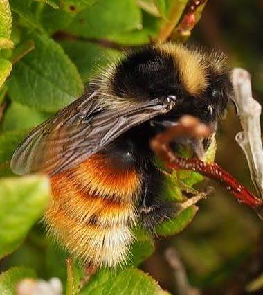
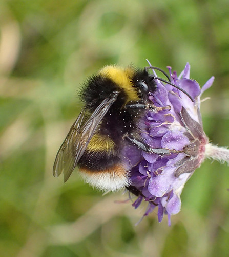
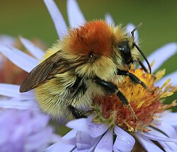

# (PART) Week 6 - Bumblebee data in R {-}

# Introduction {#intro_wk6}


## Prepare a new script

As usual, you will want to start today's practical with the following steps:

1. Open a new R script.
2. Save it under a sensible name (e.g. for today, something like `Week6Practical_Biodiversity`).
3. Add in a commented header to explain what the script is.
4. Add in the code to load our three main packages/libraries (`dplyr`, `tidyr`, and `ggplot`), as well as `patchwork`, which we will also use today.
5. Run the code the load the libraries.

::: {.rmdtip}
***Tip!***
Remember, for items 3 and 4 the easiest thing is to open your script from last week, copy and paste the relevant content, and then change the information that needs to be updated (e.g. the date and the practical number/theme in the header).
:::


## The Bumblebee data

Today's primary dataset is from [GBIF, the Global Biodiversity Information Facility](https://www.gbif.org).

From their website:

> GBIF is an international network and data infrastructure funded by the world's governments and aimed at providing anyone, anywhere, open access to data about all types of life on Earth.

> Coordinated through its Secretariat in Copenhagen, the GBIF network of participating countries and organizations, working through the participant nodes, provides data-holding institutions around the world with common standards, best practices and open-source tools enabling them to share information about where and when species have been recorded. This knowledge derives from many different kinds of sources, including everything from museum specimens collected in the 18th and 19th century to DNA barcodes and smartphone photos recorded in recent days and weeks.

The data from GBIF is occurrence data, where each observation is a sighting of an organism.

We will be focusing on three species of bumblebee that are designated as "scarce" in the UK by the [Bumblebee Conservation Trust](https://www.bumblebeeconservation.org/learn-about-bumblebees/species-guide/):

- Bilberry bumblebee (_Bombus monticola_)
- Broken-belted bumblebee (_Bombus soroeensis_)
- Moss carder bumblebee (_Bombus muscorum_)

<div style="text-align: center;">

{width=100%}

</div>
[Photo credit: Susan Loose](https://www.wwbic.org.uk/projects/projects-archive/all-wales-bilberry-bumblebee-hunt/)

<div style="text-align: center;">

{width=100%}

</div>
[Photo credit: Steven Falk](https://www.flickr.com/photos/63075200@N07/albums/72157631610322753/)

<div style="text-align: center;">

{width=100%}

</div>
[Photo credit: S. Rae](https://en.wikipedia.org/wiki/File:Bombus_muscorum_Aster_Flower_2.jpg)

We used the geographical coordinates associated each of the GBIF observations to obtain matching values of 2024 landcover data from UKCEH.


### Download and upload the data

Download today's dataset from the week 6 Moodle page: `bee_data_landcover.csv`

Upload the file to the R server and move it into your data folder. 

### Read in the data

Read in the data from the csv file.

If you use the code from a previous week, you will need to change two things: 

1. the names of the data frame you are using to store the data (I suggest something like `data_bee`)
2. the names of the csv file.

Once you run the code, you should see the data frame in your Environment tab.

Notice how many observations (rows) and variables (columns) the dataset has.

### Examine the data

Use one of the methods you've learned previously to examine the data. 

::: {.rmdtip}
***Tip!*** Remember the `unique()` function for character data and the `hist()` function for numerical data!
:::

::: {.rmdquestion}
***Questions:***

Try to answer the following questions.

- How many values of `LandCoverType` are there? What are they?
- What values can `LandCoverConfidence` have? How confident are we for most observations?
- What other columns are there?
:::

### Today's research questions


Today we will use the dataset to try to answer the following questions:

::: {.rmdquestion}
***Research Questions:***

How do the following patterns differ between species of bumblebee?

1. Large-scale geography

2. Seasonal timing

3. Associations with landcover
:::


# Geographic patterns

```{r, message=FALSE, warning=FALSE, include=FALSE}
library(dplyr, quietly = TRUE)
library(tidyr, quietly = TRUE)
library(ggplot2, quietly = TRUE)

data_bee <- read.csv("./data/bee_data_landcover.csv")

data_bee <- data_bee |>
  mutate(common_name = case_match(
    species, 
    "Bombus monticola" ~ "Bilberry bumblebee", 
    "Bombus soroeensis" ~ "Broken-belted bumblebee", 
    "Bombus muscorum" ~ "Moss carder bumblebee"))
```

We'll start by looking at the large-scale geographic patterns. 

### A basic plot

Start by making a basic scatter plot using `ggplot()`, with:

- longitude on the x-axis
- latitude on the y-axis
- the point colour indicating species

::: {.rmdtip}
***Tip!*** Remember that if colour is determined by a variable, the colour argument it has to go inside the `aes()` function!
:::

You will probably want to make the size of the points larger with `size = ` and the points somewhat transparent with `alpha = ` (where `alpha = 0` is full transparent and `alpha = 1` is fully opaque).

You can also add some nicer axis labels and a title.

```{r, echo = FALSE}
spatial_fig <- data_bee |>
  ggplot(aes(x = decimalLongitude, y = decimalLatitude, colour = species)) +
  geom_point(alpha = 0.1, size = 5) +
  labs(title = "Three rare species of UK bumblebees", x = "Longitude", y = "Latitude") +
  theme_classic()
print(spatial_fig)
```

### Create your own data frame manually

It would be nice to get a better sense of where a few locations are to orient us, particularly since we don't have an outline of the UK.

We can do that by creating our own data frame with latitude and longitude coordinates.

To create your own data frame by hand, you use the `data.frame()` function. Inside

- Each column is its own argument (e.g. `col_name = ...`)
- The values for each column are provided inside a vector (e.g. `c(x, y, z, ...)`)

The code below provides coordinates for Lancaster, London, Edinburgh, and Shetland. (I recommend typing out the overall structure to help yourself learn, but copying and pasting the coordinates.)

```{r}
landmarks_df <- data.frame(location = c("Lancaster", "London", "Edinburgh", "Shetland"),
                      lat = c(54.048622, 51.510756, 55.951889, 60.339666),
                      long = c(-2.800306, -0.122915, -3.198884, -1.224915))
```

Now we can add a `geom_text()` layer to our `ggplot` figure.

We will need to specify separate `data =`  and aesthetic (`aes()`) arguments since this layer is using a different data frame and different x and y variables than the rest of the figure. 

The `label = ` argument tells R what variable with character values to print as text.

The code below shows the correct format, but you will need to change the arguments to match your data frame and column names. 

```r
geom_text(data = city_df, aes(x = long, y = lat, label = city), colour = "black") + 
```

```{r, echo=FALSE}
spatial_fig <- data_bee |>
  ggplot(aes(x = decimalLongitude, y = decimalLatitude, colour = species)) +
  geom_point(alpha = 0.1, size = 5) +
  geom_text(data = landmarks_df, aes(x = long, y = lat, label = location), colour = "black") + 
  #scale_colour_manual(colour_vec) + 
  labs(title = "Three rare species of UK bumblebees", x = "Longitude", y = "Latitude") +
  theme_classic()
print(spatial_fig)
```


### Update colours

Change the colours to a colour palette that you like better. 

You will need to add another layer with the `scale_colour_manual()` function.

The `scale_colour_manual()` function needs an argument (`values = `) with the colours provided as a vector.

Inside the function, you need to create a vector with three different colours, either specified by [name](https://derekogle.com/NCGraphing/resources/colors) or by [hexidecimal code](https://streamlinepublishing.com/inside-art/who-put-the-hex-on-color/). You can also look at [existing colour palettes](https://coolors.co/palettes/trending). 


```{r, echo=FALSE}
spatial_fig <- data_bee |>
  ggplot(aes(x = decimalLongitude, y = decimalLatitude, colour = species)) +
  geom_point(alpha = 0.1, size = 5) +
  geom_text(data = landmarks_df, aes(x = long, y = lat, label = location), colour = "black") + 
  scale_colour_manual(values = c("darkgoldenrod1", "darkorange2", "mediumpurple3")) + 
  labs(title = "Three rare species of UK bumblebees", x = "Longitude", y = "Latitude") +
  theme_classic()
print(spatial_fig)
```

### Add common names

It would also be nice if we could put the common name in the legend instead of the scientific name. 

We can add a new column - `common_name` - with the `mutate()` function.

The code below uses `case_match()` to create new values for a `common_name` column based on the existing values in the `species` column.

```r
mydf <- mydf |>
mutate(common_name = case_match(
    species, 
    "Bombus monticola" ~ "Bilberry bumblebee", 
    "Bombus soroeensis" ~ "Broken-belted bumblebee", 
    "Bombus muscorum" ~ "Moss carder bumblebee"))
```

Change your figure to use the common names variable instead.

::: {.rmdtip}
***Tip!***

When you change the colour-determining variable from `species` to `common_name`, you will also want to change the legend label to something that is properly formatted.

You do this by adding `colour = "Whatever text label you want"` to the `labs()` function.
:::

```{r, echo=FALSE}
spatial_fig <- data_bee |>
  ggplot(aes(x = decimalLongitude, y = decimalLatitude, colour = common_name)) +
  geom_point(alpha = 0.1, size = 5) +
  geom_text(data = landmarks_df, aes(x = long, y = lat, label = location), colour = "black") + 
  scale_colour_manual(values = c("darkgoldenrod1", "darkorange2", "mediumpurple3")) + 
  labs(title = "Three rare species of UK bumblebees", x = "Longitude", y = "Latitude", colour = "Species") +
  theme_classic()
print(spatial_fig)
```

::: {.rmdquestion}
***Question:*** 

Which geographic areas are each species of bee most commonly found in?
:::


# Seasonal timing

```{r, message=FALSE, warning=FALSE, include=FALSE}
library(dplyr, quietly = TRUE)
library(tidyr, quietly = TRUE)
library(ggplot2, quietly = TRUE)

data_bee <- read.csv("./data/bee_data_landcover.csv")

data_bee <- data_bee |>
  mutate(common_name = case_match(
    species, 
    "Bombus monticola" ~ "Bilberry bumblebee", 
    "Bombus soroeensis" ~ "Broken-belted bumblebee", 
    "Bombus muscorum" ~ "Moss carder bumblebee"))

bee_month_table <- data_bee |>
  group_by(common_name, month) |>
  summarise(count = length(gbifID)) |>
  ungroup()

```

Next let's look at the seasonal timing for each bumblebee species.

## Creating a table grouped by two factors

We'll need to convert our data from a data frame where each observation is a single row, to a table format where we have the total number of data points for each month.

In previous practicals, we've used the `table()` function to do this. 

Unfortunately, the `table()` function won't work now because we need separate tallies for each species in each month. 

However, we can use the `summarise()` function, group by both variables, and then use the `length()` function to count the number of observations in each group.

It doesn't matter what variable we put inside the `length()` function, because all of the columns in a given dataframe have the same number of rows!

```r
my_two_factor_table <- mydf |>
  group_by(var1, var2) |>
  summarise(count = length(any_col)) |>
  ungroup()
```

## Stacked vs. grouped column plots

Start with a basic column plot, where:

- month is on the x-axis
- count is on the y-axis
- the colour of the bars is determined by species - remember where it goes when it is being determined by a variable!

::: {.rmdtip}
***Tip!*** For columns, the main colour is set by `fill = ` instead of `colour = `.

(The latter sets the colour of the _outline_ of the column.)
:::


```{r, echo = FALSE}
month_fig <- bee_month_table |>
  ggplot(aes(x = month, y = count, fill = common_name)) +
  geom_col() +
  theme_classic()
print(month_fig)
```

::: {.rmdquestion}
***Question:*** Does the figure look the way you expected?

(Ignore the message for now. It's not an error, just a warning, however we'll address it shortly.)
:::

The graph above is called a *stacked column plot*. 

A stacked column plot is the default for R when you give it data from multiple categories. 

This is very good for showing us the overall seasonality of bumblebees, but makes it a bit hard to see how the seasonality of each species differs.

Most of the time we want to be able to see each category separately.

One way to do that would be to simply add a `facet_wrap(vars())` layer to the end to create three different panels.

::: {.rmdtip}
***Tip!*** Remember that the variable that you are splitting into separate panels goes inside of `vars()`.
:::

```{r, echo = FALSE}
month_fig <- bee_month_table |>
  ggplot(aes(x = month, y = count, fill = common_name)) +
  geom_col() +
  theme_classic() +
  facet_wrap(vars(common_name))
print(month_fig)
```


::: {.rmdquestion}
***Question:***

We're getting an warning message that says "Warning: Removed 1 row containing missing values or values outside the scale range (`geom_col()`)."

Can you look at your input data to figure out why we're getting this error? How might you get rid of it?
:::

It seems like there are some occurrences that don't have month data associated with the, so R has filled in the value `NA`.

::: {.rmdtip}
***Tip!*** Remember that you can use the `na.omit()` function to remove all rows with any `NA` values.
:::

```r
mydf_narm <- na.omit(mydf)
```

### The `dodge` command

A better idea is to turn our plot from *stacked column plot* into a *grouped column plot*

It will be much easier to compare the patterns of each species if the values for a given month are adjacent to each other.

Copy and paste your original stacked column plot (without the `facet_wrap()` and then add the argument `position = "dodge"` to the `geom_col()` function.

```{r, echol = FALSE}
month_fig <- bee_month_table |>
  ggplot(aes(x = month, y = count, fill = common_name)) +
  geom_col(position = "dodge") +
  theme_classic()
print(month_fig)

```

Now we can really see how the seasonal patterns differ by species!

Change the colours and legend label so they match your previous geographic figure.

::: {.rmdtip}
***Tip!*** 

You will have to use a slightly different function here - `scale_fill_manual()` instead of `scale_colour_manual()` because column colours are determined by the `fill =` aesthetic instead of `colour =`.

:::

```{r, echol = FALSE}
month_fig <- bee_month_table |>
  ggplot(aes(x = month, y = count, fill = common_name)) +
  geom_col(position = "dodge") +
  scale_fill_manual(values = c("darkgoldenrod1", "darkorange2", "mediumpurple3")) + 
  labs(fill = "Species") + 
  theme_classic()
print(month_fig)

```

::: {.rmdquestion}
***Question:*** 

Which species peaks earliest in the year? Latest?
:::


# Landcover associations

```{r, message=FALSE, warning=FALSE, include=FALSE}
library(dplyr, quietly = TRUE)
library(tidyr, quietly = TRUE)
library(ggplot2, quietly = TRUE)
library(patchwork, quietly = TRUE)

data_bee <- read.csv("./data/bee_data_landcover.csv")

data_bee <- data_bee |>
  mutate(common_name = case_match(
    species, 
    "Bombus monticola" ~ "Bilberry bumblebee", 
    "Bombus soroeensis" ~ "Broken-belted bumblebee", 
    "Bombus muscorum" ~ "Moss carder bumblebee"))

landmarks_df <- data.frame(location = c("Lancaster", "London", "Edinburgh", "Shetland"),
                      lat = c(54.048622, 51.510756, 55.951889, 60.339666),
                      long = c(-2.800306, -0.122915, -3.198884, -1.224915))

bee_month_table <- data_bee |>
  group_by(common_name, month) |>
  summarise(count = length(gbifID)) |>
  ungroup()

bee_month_table <- na.omit(bee_month_table)

bee_lc_table <- data_bee |>
  filter(LandCoverConfidence >= 0.5) |>
  group_by(common_name, LandCoverType) |>
  summarise(count = length(gbifID)) |>
  ungroup()

month_fig <- bee_month_table |>
  ggplot(aes(x = month, y = count, fill = common_name)) +
  geom_col(position = "dodge") +
  scale_fill_manual(values = c("darkgoldenrod1", "darkorange2", "mediumpurple3")) + 
  labs(fill = "Species") + 
  theme_classic()

spatial_fig <- data_bee |>
  ggplot(aes(x = decimalLongitude, y = decimalLatitude, colour = common_name)) +
  geom_point(alpha = 0.1, size = 5) +
  geom_text(data = landmarks_df, aes(x = long, y = lat, label = location), colour = "black") + 
  scale_colour_manual(values = c("darkgoldenrod1", "darkorange2", "mediumpurple3")) + 
  labs(title = "Three rare species of UK bumblebees", x = "Longitude", y = "Latitude") +
  theme_classic() +
  theme(legend.position = "None")

```

Finally, let's look at landcover associations for each bumblebee species.

First you'll need to make a table for counts grouped by species and landcover, just the like the you made for species and month. 

Then, you can make a stacked column plot. 

```{r, echo = FALSE}
lc_fig <- bee_lc_table |>
  ggplot(aes(x = LandCoverType, y = count, fill = common_name)) +
  geom_col() +
  theme_classic()
print(lc_fig)
```

Hmmmm... the columns look okay, but the x-axis labels are really difficult to read. 

We can add a `theme()` layer that will rotate the text 90 degrees.

```r
  theme(axis.text.x = element_text(angle = 90))
```

::: {.rmdtip}
***Tip!*** This new `theme()` layer has to go *after* any general theme layers (e.g. `theme_classic()`, `theme_bw()`, etc.), or it will be overwritten by them.
:::

```{r, echo = FALSE}
lc_fig <- bee_lc_table |>
  ggplot(aes(x = LandCoverType, y = count, fill = common_name)) +
  geom_col() +
  theme_classic() +
  theme(axis.text.x = element_text(angle = 90))
print(lc_fig)
```

That looks much  better, but the alignment looks a bit off. 

We can add another argument (`vjust = ` or "vertical adjustment" in the direction of the text) to fix that. 

```r
  theme(axis.text.x = element_text(angle = 90, vjust = 0.5))
```

Play around and find the value for `vjust = ` that you think looks best. 

Then change the colours and legend label to match your other two graphs.

```{r, echo = FALSE}
lc_fig <- bee_lc_table |>
  ggplot(aes(x = LandCoverType, y = count, fill = common_name)) +
  geom_col() +
  scale_fill_manual(values = c("darkgoldenrod1", "darkorange2", "mediumpurple3")) +
  theme_classic() +
  labs(fill = "Species") +
  theme(axis.text.x = element_text(angle = 90, vjust = 0.3))
print(lc_fig)
```


::: {.rmdquestion}
***Questions:*** 

- Which habitats are dominated by one species of bumblebee?
- Which habitats contain a mix of bumblebee species? 
- Which habitat contains the greatest number of observations of each species?
:::


## Combine your panels via patchwork

Now you can combine your three figures into one figure using `patchwork`.

Remember that patchwork uses:

- the pipe symbol (just the vertical line `|` - not the full R pipe operator, which is written as `|>`) to put panels next to each other
- the division sign or slash `/` to put panels on top of each other
- brackets to indicate the grouping of plots

For example, the code below would put figure 1 on top of figure 2 in the left column, and then figure 3 in the right column

```r
(fig1 / fig2) | fig3  
```

If you have multiple figures with the same legend, you can combine (or "collect") them with the `plot_layout()` function and the guides argument. (You'll need to add an extra set to brackets around all the figures to make sure it refers to all of them.)


```r
((fig1 / fig2) | fig3) + plot_layout(guides = "collect") 
```

::: {.rmdtip}
***Tip!*** You may have noticed that we actually add the `plot_layout()` layer using the `+` operator, like we do with anything else in ggplot. 

This is because the output of patchwork is another ggplot-compatible object.

However as it is a set of plots rather than one single one, some things may work differently to how you expect (see [here](https://patchwork.data-imaginist.com/articles/guides/assembly.html#modifying-patches) for more details).
:::

You'll notice that you still end up with two legends - that's because `geom_point()` uses `colour =` whilst `geom_col()` uses `fill = `. So R doesn't understand that they are actually saying the same thing. 

The easiest way to fix that is to simply add a layer to your first geography plot that gets rid of one of the legends:

```r
  theme(legend.position = "None") + 
```

```{r, echo = FALSE}
(spatial_fig | (month_fig / lc_fig)) + plot_layout(guides = "collect") 
```

Remember from [Week 4](#patchwork) that you can also change the relative width and height of different rows and columns in your combined figure as shown below:

```r
fig1 | fig2 + plot_layout(widths = c(1, 2))
```

```r
 (fig1 | fig2) / fig3 + plot_layout(heights = c(1, 2))
```


# Tidying up {#tidyup_wk6}

Now it's time to tidy up and save your R script. 

As always, you will want to:

- Make sure that your code is sufficiently commented, so that someone else (or you later on!) can understand what you did.
- Delete any spare lines of code that you don't need anymore (e.g. for testing something that didn't work right away).

## Creating your own R cheatsheet

If you haven't done so yet, I **strongly** recommend creating a set of notes where you keep track of all the bits and bobs of R that you've learned.

The easiest way to do this is as a [markdown](https://www.markdownguide.org/basic-syntax/) (i.e. text) file - this will allow you to edit it and view it in RStudio, and make it more effective coding tool.

You can create a markdown file by going to: File > New File > Markdown (at the top of the 6th section down).

In weeks [3](#tidyup_wk3), [4](#tidyup_wk4), and [5](#tidyup_wk5) I listed out all of the functions that we used in the first four practicals, grouped by type and then in alphabetical order.

You can copy and paste this list into your markdown file, and then add your own annotations / descriptions that will help you remember how they work.

Remember to also add the functions from the last few weeks if you haven't already!

The new functions from this week are:

### General / data analysis

- `data.frame()`
- `mutate()`
- `case_match()`

### ggplot functions

- `plot_layout(guides = "collect")`
- `scale_colour_manual()`
- `scale_fill_manual()`
